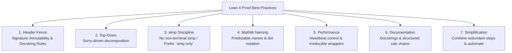
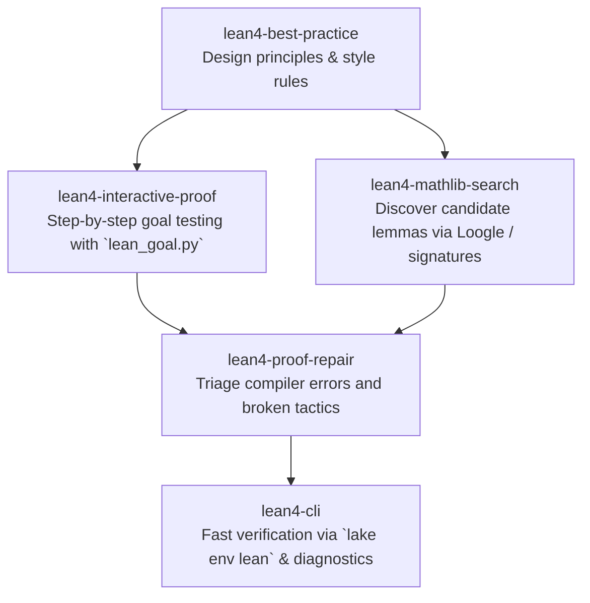

# Lean 4 Best Practice Guide

This skill provides an authoritative guide to writing clean, maintainable, performant, and idiomatic Lean 4 mathematical proofs adhering to Mathlib community standards.

---

## 1. The Seven Pillars of Lean 4 Proving

Every high-quality formal proof in Lean 4 rests on seven foundational practices:

1. **Header Fence & Contract Integrity**: Declaration headers and type signatures are **immutable contracts**. Never weaken a theorem, add auxiliary hypotheses, or introduce custom axioms to force proof completion. Adhere to Docstring Scoping Rules A/B/C (preserve existing docstrings under Rule A).
2. **Top-Down (Sorry-Driven) Proving**: Design the architecture of your proof first. Use `sorry` to establish the high-level roadmap and extract helper lemmas before sinking time into technical details.
3. **`simp` Hygiene**: Never leave an open, non-terminal `simp` in the middle of a proof. Use `simp only [...]`, `dsimp`, or `simp_rw` to guarantee proof stability across library versions.
4. **Mathlib Naming Fluency**: Leverage predictable naming schemes (`Type.op_property`) and dot notation to deduce existing lemma names without endless searches.
5. **Performance & Heartbeat Control**: Keep elaboration times small. Never treat `set_option maxHeartbeats` as a permanent fix; resolve instance loops, pin type parameters, and use targeted tactics.
6. **Human-Readable Documentation & Style**: Formal proofs must be readable by mathematicians. Write informative docstrings, maintain a 100-character line limit, and use structured `calc` proofs for calculational arguments.
7. **Principled Simplification (Golfing)**: Eliminate redundant tactics and intermediate hypotheses. Prefer domain decision tactics (`omega`, `ring`, `linarith`, `gcongr`) for single domains and SMT-style `grind` for cross-domain mixed constraints over fragile manual rewrites.

---

## 2. Fast Prover Checklist

Before submitting or completing any Lean 4 proof, verify against this checklist:

### Stage A: Architecture & Strategy

- [ ] **Header Fence Respected**: Is the declaration header and type signature before `:= by` completely untouched? Have you refrained from adding convenient premises or custom axioms?
- [ ] **Top-Down Decomposition**: Is the main theorem broken down into modular `have` steps or standalone helper lemmas rather than a 100-line monolithic tactic block?
- [ ] **Hardest Case First**: If doing case analysis or induction, is the most difficult branch solved or planned first before doing routine base cases?

### Stage B: Tactic Discipline

- [ ] **No Non-Terminal `simp`**: Does every `simp` either close the goal completely or use an explicit lemma list (`simp only [...]`)?
- [ ] **Focus Dots (`·`)**: Are all branches in `induction`, `cases`, `constructor`, or `apply` isolated using focus dots?
- [ ] **Arithmetic Segregation**: Is `omega` used for `ℕ`/`ℤ` Presburger arithmetic, and `linarith` reserved for linear relations over `ℝ`/`ℚ`?
- [ ] **Cross-Domain Automation**: For mixed goals involving equalities, inequalities, and case analysis, is `grind` tested safely (`grind (splits := 0)` or `grind?`) rather than unconstrained searches?
- [ ] **Calculation Legibility**: Are multi-step inequalities or equalities laid out with `calc` rather than a sequence of opaque rewrites?

### Stage C: Documentation & Layout

- [ ] **Docstring Rule A Followed**: When editing existing theorems, are existing `/-- ... -/` docstrings preserved without modification?
- [ ] **New Declarations Documented (Rule C)**: Does every newly authored helper lemma or definition have an informative docstring?
- [ ] **Module Header**: Does the file contain a proper module docstring `/-! ... -/` after imports explaining its mathematical purpose?
- [ ] **Line Length**: Are all lines within 100 characters?

### Stage D: Performance, Hygiene & Soundness

- [ ] **No Artificial Heartbeat Inflation**: Does the proof build cleanly without increased `maxHeartbeats`?
- [ ] **Clean Hygiene**: Are there any leftover debugging traces, `#check`, `#eval`, or unused variables?
- [ ] **Soundness & Axiom Check**: Has `#print axioms <Theorem>` been checked to confirm the proof depends strictly on standard axioms (`propext`, `Classical.choice`, `Quot.sound`) with no residual `sorryAx` or custom axioms?

---

## 3. Progressive Reference Guides

For in-depth explanations, code templates, and antipattern corrections, consult the specialized references:

| Topic                         | Key Focus & Techniques                                               | Guide                                                                                 |
| :---------------------------- | :------------------------------------------------------------------- | :------------------------------------------------------------------------------------ |
| **Header Fence & Docstrings** | Signature immutability, preventing goal drift, Docstring Rules A/B/C | [header_fence_and_docstrings.md](references/header_fence_and_docstrings.md)           |
| **Top-Down Proving**          | Sorry-driven development, helper extraction, hardest-case-first      | [sorry_driven_development.md](references/sorry_driven_development.md)                 |
| **`simp` Hygiene**            | Non-terminal `simp` hazards, `simp only`, `dsimp`, `simp_rw`, simpNF | [simp_discipline.md](references/simp_discipline.md)                                   |
| **Mathlib Naming**            | Naming formula, head-symbol rules, connectives, dot notation         | [mathlib_naming_conventions.md](references/mathlib_naming_conventions.md)             |
| **Performance**               | Heartbeat limits, instance resolution, `@[irreducible]`, profiling   | [performance_and_heartbeats.md](references/performance_and_heartbeats.md)             |
| **Documentation & Style**     | File headers, docstrings, `calc` layout, line length, formatting     | [documentation_and_style.md](references/documentation_and_style.md)                   |
| **Proof Simplification**      | Redundant step fusion, term vs tactic mode, automation solvers       | [proof_simplification_and_golfing.md](references/proof_simplification_and_golfing.md) |

---

## 4. Synergy with Lean 4 Skills Ecosystem

`lean4-best-practice` guides the methodology while other skills provide toolchain and lookup support:

- When constructing a top-down proof, use `skills/lean4-interactive-proof` to inspect goals between `sorry` placeholders.
- When searching for lemmas conforming to Mathlib naming, use `skills/lean4-mathlib-search`.
- If a proof refactoring produces compiler errors, triage them with `skills/lean4-proof-repair`.
- Validate overall project health and compilation times using `skills/lean4-cli`.
