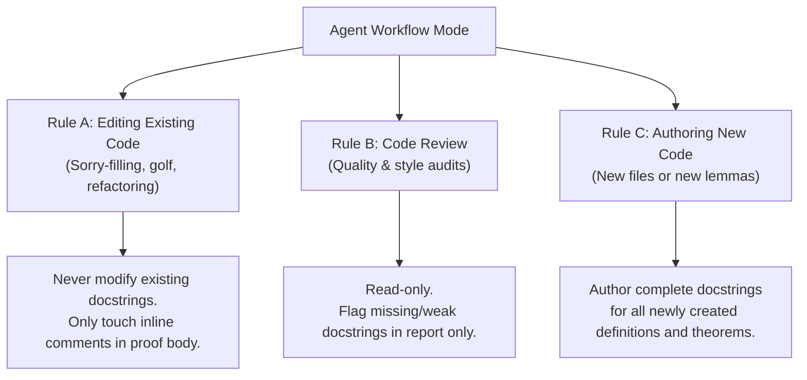

# Header Fence and Docstring Scoping Rules

When AI agents work on Lean 4 mathematical proofs, maintaining architectural stability and API contracts is paramount. Two critical failure modes must be strictly prevented:

1. **Goal Drift / Contract Violation**: Silently modifying theorem signatures or adding convenient hypotheses when a proof is difficult.
2. **Docstring Churn / Regression**: Gratuitously rewriting existing API documentation and mathematical descriptions during routine proof filling.

---

## 1. The Header Fence Principle

### 1.1. What is the Header Fence?

The **header** of a declaration consists of everything from the keyword (`theorem`, `lemma`, `def`, `instance`) up to the assignment operator `:=` (e.g. `:= by`):

```lean
-- [--- DECLARATION HEADER (IMMUTABLE FENCE) ---]   [--- PROOF BODY ---]
theorem sum_le_sum (s : Finset ι) (f g : ι → ℝ) :   (∑ i ∈ s, f i ≤ ∑ i ∈ s, g i) := by
  sorry
```

> [!IMPORTANT]
> **The Header Fence Rule**: Declaration headers and type signatures are **immutable contracts**. Unless the user explicitly instructs you to change a theorem statement, everything before `:=` is strictly off-limits.

### 1.2. Why the Header Fence Exists

1. **Preventing Goal Drift**: When proof attempts fail, an unconstrained LLM often weakens the theorem, adds stronger preconditions, or introduces an arbitrary `axiom` to make the proof succeed trivially. This creates the illusion of success while failing to prove the intended mathematical theorem.
2. **Preventing Downstream Breakage**: The theorem signature is an exported contract. Modifying types or binder order breaks downstream call sites across the project.
3. **Epistemological Honesty**: If a theorem statement contains a bug, requires missing hypotheses, or is mathematically false:
   - Do NOT silently modify the original header.
   - Halt, isolate the obstacle or counterexample, and report the issue to the user.
   - If appropriate, formulate a separate new lemma (e.g., `my_theorem_corrected`) without altering the original target.

### 1.3. What You May and May Not Modify

| Area                      | Permitted Actions                                                           | Prohibited Actions                                                                                      |
| :------------------------ | :-------------------------------------------------------------------------- | :------------------------------------------------------------------------------------------------------ |
| **Declaration Header**    | Read only. Type-check against callers.                                      | Adding hypotheses, altering types, changing binder brackets (`()` vs `{}` vs `[]`), renaming variables. |
| **Proof Body (`by ...`)** | Refactor, simplify, golfers, decompose with `have`/`obtain`, apply tactics. | Calling `axiom` or relying on unverified assumptions outside standard Mathlib axioms.                   |
| **Custom Axioms**         | None. Standard axioms only (`propext`, `Classical.choice`, `Quot.sound`).   | Introducing temporary `axiom` declarations to bridge gaps.                                              |

---

## 2. Docstring Scoping Rules (Rules A, B, and C)

Existing docstrings represent established mathematical specifications and API documentation. Agents must adhere to a strict three-tier scoping discipline based on their operating mode:



### 2.1. Rule A: Editing Existing Declarations (Proof Work)

When filling `sorry`, refactoring proof tactics, or golfing existing proofs:

- **Never rewrite or touch existing declaration docstrings (`/-- ... -/`) or module docstrings (`/-! ... -/`)** unless the user explicitly asks for docstring edits.
- You **may** freely add, modify, or prune inline comments (`--` or `/- ... -/`) inside the proof body (after `:= by`).
- **Rationale**: Keeps git diffs focused entirely on mathematical proof steps and prevents accidental deletion of mathematical citations or rationale.

### 2.2. Rule B: Code Review Mode (Auditing)

When reviewing Lean 4 files for quality and standards:

- The workflow is **strictly read-only**. Never mutate files directly.
- If a docstring is missing, vague, or does not follow Mathlib conventions, flag it in the review report and suggest candidate replacement text for the user to approve.

### 2.3. Rule C: Creating New Declarations (Drafting / Decomposition)

When drafting new helper lemmas, extracting lemmas from a large proof, or creating new `.lean` files:

- **Mandatory Documentation**: You must emit complete, informative docstrings (`/-- ... -/`) for every new top-level theorem, definition, and public helper lemma.
- For new files, write a standard module header docstring (`/-! ... -/`) immediately following the `import` statements explaining the mathematical scope, main definitions, and theorems.
- Once created and committed, subsequent edits to those declarations immediately fall under **Rule A**.

### 2.4. Placement Rule: Scoped Command Prefixes and Docstrings

When attaching scoped command modifiers (`omit [...] in`, `open ... in`, or `set_option ... in`) to a declaration that has a docstring:

- **Always place the command prefix BEFORE the docstring**:
  ```lean
  -- ⭕ CORRECT: Scoped command modifier wraps the docstring and declaration
  omit [IsGalois F E] in
  /-- Intermediate field fixed by the fixing subgroup coincides with original field. -/
  theorem fixingSubgroup_fixedField_eq (H : Subgroup (E ≃ₐ[F] E)) : ...
  ```
- **Never place the command prefix between the docstring and the declaration keyword**:
  ```lean
  -- ❌ INCORRECT: Causes "unexpected token 'omit'; expected 'lemma'" parser error
  /-- Intermediate field fixed by the fixing subgroup coincides with original field. -/
  omit [IsGalois F E] in
  theorem fixingSubgroup_fixedField_eq (H : Subgroup (E ≃ₐ[F] E)) : ...
  ```
- **Grammar Rationale**: In Lean 4's syntax, `/-- ... -/` is part of `declModifiers`, which must immediately precede the declaration keyword (`theorem`, `lemma`, `def`, `instance`). Modifiers like `omit ... in` operate at the command level and expect a whole command declaration (including its leading docstring) to follow `in`.

---

## 3. Checklist for Contract & Docstring Integrity

Before completing any task that modifies Lean 4 source files, verify:

- [ ] **Header Diff Check**: Did you run `git diff` to ensure that line diffs are strictly confined to the proof body after `:= by`?
- [ ] **No Unsanctioned Preconditions**: Did you refrain from adding new premises `(h : ...)` to the theorem statement?
- [ ] **No Axiom Infiltration**: Did you verify that no new `axiom` statements were introduced?
- [ ] **Docstring Preservation**: Are all original `/-- ... -/` docstrings completely unchanged?
- [ ] **Docstring & Modifier Order**: If using scoped command modifiers (`omit [...] in`, `open ... in`, `set_option ... in`), are they placed _before_ the `/-- ... -/` docstring rather than between the docstring and theorem keyword?
