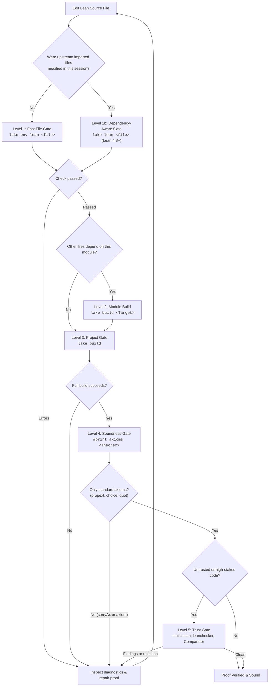

# Lean 4 CLI and Lake Build Management

This skill provides operational workflows and automated tools for managing Lean 4 projects using Lake (the Lean build tool) and Elan (the Lean version manager). It guides agents in fetching pre-compiled Mathlib caches, executing fast file-level type checks, running incremental or full project builds, auditing proof soundness via `#print axioms`, static risk scans and kernel replay, and parsing compiler diagnostics into structured JSON.

---

## 0. Environment & Version Compatibility

| Component         | Target / Supported          | Verified / Tested Version             | Notes                                            |
| :---------------- | :-------------------------- | :------------------------------------ | :----------------------------------------------- |
| **Lean 4 / Lake** | `^4.14.0` (4.14.0+)         | `v4.35.0` (Release, commit `eb6cafb`) | Verified via Lake CLI build & single-file check  |
| **Mathlib**       | Compatible with target Lean | Contemporary with Lean `v4.35.0`      | Uses `lake exe cache get` for pre-built `.olean` |
| **Python**        | `>=3.10`                    | `3.14.x`                              | For `scripts/*.py`; `library_dag.py` needs 3.11+ |

### Version-Specific CLI & Build Notes

- **Lake Configuration**: Modern Lean 4 projects use either `lakefile.toml` or `lakefile.lean`. Ensure commands are executed in the project root containing `lean-toolchain`.
- **Diagnostic Formatting**: Modern Lean 4 compiler output is parsed into structured JSON via `scripts/parse_diagnostics.py`.
- **Mathlib Cache Retrieval**: Always invoke `lake exe cache get` before full compilation to avoid building Mathlib from source.

---

## 1. Quick Reference: Common Commands

| Command                         | Purpose                                    | When to Use                                                                |
| :------------------------------ | :----------------------------------------- | :------------------------------------------------------------------------- |
| `lake exe cache get`            | Fetch Mathlib pre-compiled `.olean` cache  | **Mandatory** on fresh workspace setup or after modifying `lakefile`       |
| `lake exe mathlib/cache get`    | Run Mathlib's own `cache` tool explicitly  | When the project defines its own `cache` executable (§3)                   |
| `lake exe cache get!`           | Force re-download of Mathlib cache         | When `.olean` files are corrupted or type errors occur in Mathlib          |
| `lake env lean <file>`          | Fast single-file type checking             | **Primary verification loop** while actively editing Lean code             |
| `lake build <Module>`           | Build specific library module or target    | After cross-file modifications or adding new imports                       |
| `lake build`                    | Full project verification                  | Checkpoint gate or before completing the proof task                        |
| `lake build --no-build`         | Check targets are up to date, compile none | After fetching a cache; exit code `3` means something needs a build        |
| `#print axioms <theorem>`       | Audit proof soundness and axioms           | **Final gate** to ensure no `sorryAx` or custom axioms exist               |
| `scan_risky_constructs.py`      | Static scan for trust-base risks           | Reviewing code written by other agents, contributors or submissions        |
| `#unused_hypotheses <Prefix>`   | Find `Prop` hypotheses a proof never uses  | Conditional proofs whose types may misreport their dependencies            |
| `#duplicate_fields <Bundle>`    | Find bundle fields with the same type      | Bundles of cited results that may cite one proposition twice               |
| `#duplicate_decls <Prefix>`     | Find copies of theorems and definitions    | Projects with copied files or retried lemmas (`foo_alt`, `foo_bis`)        |
| `#long_decls <N> <Prefix>`      | Find declarations longer than `N` lines    | CI limits on proof size; finding monolithic theorems to split              |
| `import_depth.py --max-depth N` | Measure the longest import chain           | CI limits on the build's critical path; finding proofs that import proofs  |
| `library_dag.py --allow <FILE>` | Check imports between libraries            | CI limits on which `[[lean_lib]]` may import which; finding library cycles |
| `lake env leanchecker <Module>` | Replay compiled declarations in the kernel | High-stakes results; detecting "environment hacking"                       |
| `elan show`                     | Show current active toolchain and override | When inspecting Lean version consistency or environment issues             |

---

## 2. Environment and Toolchain Inspection

Lean 4 projects require the correct toolchain version specified in `lean-toolchain`.

### Checking Active Toolchain

```bash
# Check the currently active Lean and Lake toolchains
elan show

# Verify Lean and Lake versions
lean --version
lake --version
```

### Locating the Project Root

Always run `lake` commands from the project root directory (where `lakefile.lean` or `lakefile.toml` exists):

- If `lakefile.lean` or `lakefile.toml` is in the current directory, proceed with standard commands.
- If in a subdirectory, navigate or pass `--dir` if supported. Running commands outside the project root causes `unknown package` errors because Lake cannot set the module search paths (`LEAN_PATH`).

---

## 3. Mathlib Cache Management (Critical)

Mathlib contains hundreds of thousands of lines of formalized mathematics. Compiling Mathlib locally from source takes hours and will consume all CPU cores. **Never run `lake build` in a Mathlib-dependent project without priming the cache first.**

### Fetching the Cache

Execute the cache retrieval command from the project root:

```bash
# Standard command for Mathlib-dependent repositories
lake exe cache get
```

_Note: `lake cache get` (no `exe`) is a different command: Lake's built-in remote cache, which downloads from Reservoir or from a service configured in the lakefile's `[cache]` table. It is not Mathlib's `cache` tool. Use `lake exe cache get` for Mathlib's `.olean` cache unless the project documents otherwise._

### Which `cache` Executable Runs

`lake exe cache` runs the executable named `cache` that Lake finds in the workspace, and **the root package's executable wins over a dependency's**. Most projects have no `cache` executable of their own, so the command reaches Mathlib's. A project that defines one (for example, to download its own prebuilt modules as well) shadows Mathlib's tool, and `lake exe cache get` then does whatever that project's tool does.

Qualify the target with the package name to run a specific package's executable:

```bash
lake exe mathlib/cache get     # always Mathlib's cache tool, Mathlib's .olean files only
```

Check the lakefile for a `[[lean_exe]]` named `cache` (or `lean_exe cache` in `lakefile.lean`) before running the bare command. When verifying a project independently, use `lake exe mathlib/cache get` so that no prebuilt artifacts of the project itself are downloaded; otherwise `lake build` can finish without compiling anything.

### Checking That the Cache Covers the Build (`lake build --no-build`)

After fetching a cache, confirm that it matches the current sources without starting a long compilation:

```bash
lake build --no-build          # exit 0: every target is up to date; exit 3: something needs a build
lake build MyModule --no-build # the same check for one target
```

Exit code `3` means that some module's sources, options, dependencies or toolchain differ from what the cache was built for. Find the cause (an edited file, a changed lakefile option, a different toolchain) before running a full `lake build`, which may take hours on a large project.

### Build and Cache Environment Variables

| Variable                    | Read by             | Effect                                                                                                                  |
| :-------------------------- | :------------------ | :---------------------------------------------------------------------------------------------------------------------- |
| `MATHLIB_CACHE_GET_URL`     | Mathlib `cache` exe | Download from this single URL instead of the default storage containers (e.g. a mirror or another official server)      |
| `MATHLIB_CACHE_DIR`         | Mathlib `cache` exe | Local cache directory (default `~/.cache/mathlib`)                                                                      |
| `LAKE_ARTIFACT_CACHE=false` | Lake                | Disables Lake's local artifact cache, shared across copies of a project; by default Lake may **read** artifacts from it |
| `LEAN_ABORT_ON_PANIC=1`     | Lean runtime        | Aborts the process on a panic instead of printing `PANIC` and continuing with a default value                           |

- For an **independent rebuild** (verifying someone else's proof), set `LAKE_ARTIFACT_CACHE=false` so that Lake does not reuse artifacts that an earlier session or setup script placed in the local artifact cache.
- For **verification and CI runs**, set `LEAN_ABORT_ON_PANIC=1` so that an internal error stops the build instead of being lost in the log. Comparator runs Lean this way.

### Corrupted Cache Recovery

If compilation reports unexpected errors inside Mathlib files (e.g., checksum mismatch, invalid olean header, or broken imports):

```bash
# Force re-download of all cache artifacts
lake exe cache get!

# If necessary, clean build artifacts and re-fetch
lake clean
lake exe cache get
```

---

## 4. Verification Ladder: Fast File Gate to Soundness Gate

To maintain fast turnaround times and guarantee strict mathematical rigor, follow this multi-tier verification ladder (from lightest to full verification):

| Tier                               | Tool / Command                                          | Dependency Handling                                         | Target `.olean` Written | Speed            | Best For                                                      |
| :--------------------------------- | :------------------------------------------------------ | :---------------------------------------------------------- | :---------------------- | :--------------- | :------------------------------------------------------------ |
| **Tier 0: Per-Edit**               | `lean_goal.py` / LSP diagnostics                        | In-memory LSP server state                                  | No                      | Sub-second       | Interactive goal inspection after each tactic line            |
| **Tier 1: Fast File Gate**         | `lake env lean <path/to/File.lean>`                     | Reads **existing pre-built `.olean`** only                  | No                      | Seconds          | Fast syntax/type check when upstream imports are unchanged    |
| **Tier 1b: Dependency-Aware Gate** | `lake lean <path/to/File.lean>` (Lean 4.8+)             | **Builds stale imports**, then checks file                  | No                      | Fast             | File check after editing upstream imports in the same session |
| **Tier 2: Module Build**           | `lake build <Module>`                                   | Rebuilds dependencies + target                              | **Yes**                 | Moderate         | Writing module `.olean` artifacts for downstream consumers    |
| **Tier 3: Project Gate**           | `lake build`                                            | Full workspace build graph                                  | **Yes**                 | Minutes          | Pre-commit checkpoint and whole-project validation            |
| **Tier 4: Soundness Gate**         | `#print axioms <Theorem>`                               | Kernel check on environment                                 | N/A                     | Sub-second       | Mandatory audit: eliminate `sorryAx` and synthetic axioms     |
| **Tier 5: Trust Gate**             | `scan_risky_constructs.py` → `leanchecker` → Comparator | Source scan, then kernel replay of `.olean` files / exports | No                      | Seconds to hours | Code from other agents, contributors or external submissions  |



### Level 1: Fast File Gate (`lake env lean <file>`)

- **Command**: `lake env lean <path/to/File.lean>`
- **Characteristics**: Elaborates the single source file against the currently built import environment. It reads existing `.olean` binaries and **does not rebuild** imported modules.
- **Speed**: Seconds (vs. minutes for `lake build`).
- **Use case**: Run immediately after editing a local theorem or proof step when upstream imported files have not changed.

### The Lakefile Options Trap (File Gate Scope)

> [!WARNING]
> `lake env lean <File.lean>` does **not** apply the lakefile's `leanOptions` or `moreLeanArgs` (verified on Lean `v4.33.1`). `lake build`, `lake lean <file>` and the language server do apply `leanOptions`.
> In a project that sets options such as `maxSynthPendingDepth`, `maxHeartbeats`, `autoImplicit` or `--tstack` in its lakefile, the file gate can report **false failures** (a raised limit is missing) or **false passes** (a stricter setting or linter is missing).
>
> - Check the lakefile for `leanOptions` / `moreLeanArgs` before trusting a `lake env lean` result.
> - Prefer `lake lean <path/to/File.lean>` (Tier 1b) in such projects, or pass the options explicitly: `lake env lean -DmaxSynthPendingDepth=3 <file>`.
>
> See `lean4-best-practice` → `performance_and_heartbeats.md` (§4) for the full entry-point table.

### The Stale `.olean` Cache Trap (File Gate Scope)

> [!WARNING]
> `lake env lean <File.lean>` elaborates against the **compiled `.olean` binaries** of imported modules, NOT their raw source code.
> If an imported module was edited in the same session without being recompiled, the file gate can produce:
>
> 1. **False Pass**: The file gate succeeds because it reads the old `.olean` where a modified or removed upstream definition still exists. The failure only surfaces later during full `lake build`.
> 2. **False Failure**: The file gate fails because it cannot see a new lemma or signature change made in the upstream `.lean` source file, leading to confusion and unnecessary debugging.

#### Recovery Protocols for Cross-File Edits

When editing across multiple files or modifying upstream dependencies, choose one of these two recovery paths:

1. **Path A (`lake lean <file>`, Recommended, Lean 4.8+)**:
   ```bash
   lake lean path/to/File.lean
   ```
   `lake lean` is dependency-aware: it automatically recompiles any modified upstream imports first, then elaborates the target file. Crucially, it does **not** write the target file's own `.olean`, keeping the check fast and avoiding artifact pollution if the file is later rolled back. _(Note: On Lean < 4.8, `lake lean` is not available; use Path B instead.)_
2. **Path B (Explicit Rebuild)**:
   Rebuild the modified dependency first, then run `lake env lean`:
   ```bash
   lake build "MathProof.Data.UpstreamModule" -q --log-level=info
   lake env lean path/to/DownstreamFile.lean
   ```

### Level 2: Incremental Module Build (`lake build <Module>`)

- **Command**: `lake build MathProof.MyModule -q --log-level=info`
- **Characteristics**: Compiles the target module and writes its `.olean` file to disk so downstream modules can consume it.
- **Use case**: When another file in the project depends on changes made in the current file.

#### Module Path Conversion & Escaping Rules (`«...»`)

When targeting a specific module with `lake build`, file paths are converted to dot-separated Lean hierarchical identifiers (`/` → `.`, omitting `.lean`):
`MathProof/Algebra/Basic.lean` → `MathProof.Algebra.Basic`

**Critical: Handling Hyphens and Non-Standard Directory/File Names**:
Lean 4 identifiers follow standard language grammar: hyphens (`-`) are parsed as minus/subtraction operators, and identifiers cannot start with digits or contain special punctuation. If a directory or file in the path contains a hyphen (e.g. `my-submodule`), running `lake build` with a plain string will fail with an `unknown target` error:

- ❌ **Fails**: `lake build MathProof.Data.my-submodule.Basic` (Lake parses `-` as an operator)
- ✅ **Correct (Escaped with French Quotes `«...»`)**:
  ```bash
  lake build "MathProof.Data.«my-submodule».Basic" -q --log-level=info
  ```

> [!TIP]
> In Lean 4, enclosing any string within guillemets (`«` and `»`, French quotation marks) escapes it as a valid atomic identifier (e.g., `«my-submodule»`, `«123-custom»`). In shell environments (bash/zsh), always wrap the full target string in double quotes (`"..."`) or single quotes to prevent the shell from misinterpreting special characters.

### Level 3: Project Gate (`lake build`)

- **Command**: `lake build` (or `lake build -q --log-level=info` to reduce output tokens)
- **Characteristics**: Compiles all targets across the workspace, verifies inter-module consistency, and executes linters if configured.
- **Use case**: Checkpoint gate before considering work finished or handing off a completed proof.

> [!NOTE]
> **Beware of the `[N/M]` Progress Counter**:
> Lake dynamically discovers dependencies during compilation, causing the denominator $M$ to increase mid-build (e.g., jumping from `[120/150]` to `[120/7800]`). The fraction is not a linear percentage estimate; gauge timeouts and progress by wall-clock time and active compiler output rather than the step count.

### Level 4: Soundness Gate (`#print axioms <Theorem>`)

- **Command**: `#print axioms <TheoremName>` (evaluated at the bottom of the file or via stdin)
- **Characteristics**: Verifies that the completed proof depends strictly on Lean 4 / Mathlib's legitimate foundation and contains no illicit shortcuts or unproven premises.
- **Use case**: **Mandatory** before concluding any formalization task.

### Level 5: Trust Gate (Static Scan, Kernel Replay, Comparator)

- **Commands**: `python3 <skill-path>/scripts/scan_risky_constructs.py`, then `lake env leanchecker <Module>`, and for external submissions `lake comparator` against a Mathlib-only challenge file.
- **Characteristics**: Goes beyond the axiom list. Flags elaborator bypasses, environment manipulation and global notation in the source, re-checks compiled declarations in the kernel, and fixes the theorem statement independently of the proof.
- **Use case**: Code written by other agents, contributors or external submissions, and any result that must be trusted without trusting its author. See "Beyond `#print axioms`" in §5.

---

## 5. Soundness & Axiom Verification (`#print axioms`)

A proof that compiles cleanly can still be mathematically unsound if it inadvertently depends on unresolved `sorry` statements or synthetic axioms introduced during experimentation.

### Standard vs. Illicit Axioms

| Axiom Class                | Specific Axioms                                                                         | Assessment                                                                                      |
| :------------------------- | :-------------------------------------------------------------------------------------- | :---------------------------------------------------------------------------------------------- |
| **Standard Mathlib Found** | `propext`<br/>`Classical.choice`<br/>`Quot.sound` / `quot.sound`                        | **ACCEPTABLE**: Foundation of classical mathematics in Lean 4.                                  |
| **Native Evaluation**      | `*._native.*` (Lean `v4.29.0`+)<br/>`Lean.ofReduceBool` (older)                         | **RESTRICTED**: `native_decide` / `bv_decide` trust compiled code; needs explicit user consent. |
| **Residual Sorry**         | `sorryAx`                                                                               | **STRICTLY FORBIDDEN**: An unproven `sorry` remains in the proof.                               |
| **Custom / Synthetic**     | Any identifier declared via `axiom ...` (e.g. `my_axiom`, `unproved_helper_hypothesis`) | **STRICTLY FORBIDDEN**: Proof cheats by postulating claims.                                     |

### How to Run Axiom Audits

#### Method 1: Inline Verification (Recommended for Quick Checks)

Temporarily append `#print axioms <TheoremName>` to the bottom of the `.lean` file and run:

```bash
lake env lean path/to/File.lean
```

**Example Output (Sound Proof):**

```text
'my_theorem' depends on axioms: [propext, Classical.choice, Quot.sound]
```

If you see `sorryAx` or any custom identifier, the proof is **not complete**. Immediately remove the temporary `#print axioms` line after inspection.

#### Method 2: Stdin One-Liner (No File Modification)

Run without editing the source file:

```bash
lake env lean --stdin <<EOF
import MyProject.MyModule
#print axioms MyProject.MyModule.my_theorem
EOF
```

### Beyond `#print axioms` (Trust Gate)

A clean axiom list does **not** show that the statement means the intended mathematics, that no custom tactic bypassed the elaborator, or that the environment was not manipulated. For code you did not write entirely yourself in this session:

1. **Static scan**: List trust-base risks across the project (comments and strings are ignored):

   ```bash
   python3 <skill-path>/scripts/scan_risky_constructs.py src/ --exclude 'src/Challenge.lean'
   ```

   Exit code `1` means a `critical` finding (`sorry`, `axiom`, `native_decide`, `debug.skipKernelTC`, ...). Read every `warning` finding as well, especially `goal-assignment` (a custom tactic that assigns the goal without the elaborator's type check) and `global-notation`. Custom tactics, terms and commands that hide such a construct are followed to every use, including through other macros, and reported as `<rule>-via-syntax` (e.g. `goal-assignment-via-syntax`). Use `--json` for structured output; large projects are scanned in parallel automatically (`--jobs`).

2. **Statement fidelity review**: Check that each primary statement uses Mathlib's definitions, excludes junk-value points, and elaborates numeric literals in the intended type.
3. **Kernel replay**: `lake env leanchecker <Module>` (add `--fresh` for one module replayed from an empty environment) re-checks compiled declarations and detects "environment hacking".
4. **Challenge/Solution check**: For untrusted results, state the theorems in a file that imports only Mathlib, and judge the solution with Comparator and independent kernels.

> [!WARNING]
> Compiling untrusted Lean code runs its metaprograms (`initialize`, `run_cmd`, `elab`, `#eval`). Build untrusted projects in a sandbox without network access, and never treat a shared build cache as evidence that the proofs are valid.

For full details on handling private declarations, namespace scope stacks, eliminating synthetic axioms, the axioms that `native_decide` adds in each Lean version, the scanner's rule catalog and JSON schema, the statement review checklist, `leanchecker`, and the Comparator workflow, consult the comprehensive guide:

- [Soundness and Axiom Audit Guide](references/soundness_and_axiom_audit.md)

---

## 6. Structured Diagnostics Parsing (`parse_diagnostics.py`)

The skill bundles `scripts/parse_diagnostics.py`, a zero-dependency script using only the Python standard library. It parses console outputs from `lake` and `lean` (including multi-line errors and ANSI color sequences) and returns a structured JSON payload.

### Usage Options

#### Option A: Direct Command Execution (`--run`)

Automatically runs the command, captures stdout/stderr, and parses output:

```bash
python3 <skill-path>/scripts/parse_diagnostics.py --run "lake env lean MathProof/Basic.lean"
python3 <skill-path>/scripts/parse_diagnostics.py --run "lake build"
```

#### Option B: Pipe Output via Stdin

```bash
lake env lean MathProof/Basic.lean 2>&1 | python3 <skill-path>/scripts/parse_diagnostics.py
```

#### Option C: Parse Existing Log File

```bash
python3 <skill-path>/scripts/parse_diagnostics.py build.log
```

#### Option D: Fail on Selected Linters

`--fail-on-linter OPTION` turns every diagnostic of that linter into a failure (`success: false`, exit code `1`), even when the build itself succeeded. `--fail-path-prefix PREFIX` limits this to files under the given paths. Both options can be repeated.

```bash
# Fail when a proof file has an unused hypothesis; warnings elsewhere are only counted.
lake build 2>&1 | python3 <skill-path>/scripts/parse_diagnostics.py --summary-only \
  --fail-on-linter linter.unusedVariables --fail-path-prefix MyProject/Proofs
```

The linter of a warning is read from the note Lean appends to it (``Note: This linter can be disabled with `set_option linter.unusedVariables false` ``). For unused statement hypotheses, see `lean4-best-practice` → `statement_first_decomposition.md` (§3.10), which also explains why the linter must be combined with `scripts/unused_hypotheses.lean`.

### JSON Output Schema

```json
{
  "success": false,
  "exit_code": 1,
  "error_count": 1,
  "warning_count": 0,
  "info_count": 0,
  "linter_counts": {},
  "summary": "1 error(s), 0 warning(s), 0 info(s)",
  "diagnostics": [
    {
      "file": "MathProof/Basic.lean",
      "line": 15,
      "column": 4,
      "severity": "error",
      "error_name": null,
      "message": "type mismatch\n  has type\n    Nat\n  but is expected to have type\n    String",
      "linter": null
    }
  ]
}
```

### Fields

- `success`: `true` if exit code is 0, `error_count == 0` and, with `--fail-on-linter`, `linter_failure_count == 0`.
- `exit_code`: Process return code.
- `error_count`: Number of errors detected.
- `warning_count`: Number of warnings detected.
- `info_count`: Number of informational diagnostics detected.
- `linter_counts`: Number of diagnostics per linter option (e.g. `{"linter.unusedVariables": 152}`), most frequent first. Use it to see which linters a large build triggers before deciding which ones to enforce.
- `linter_failure_count`: (Only with `--fail-on-linter`) Number of diagnostics that matched the selected linters and paths.
- `summary`: Short human-readable summary string.
- `diagnostics`: List of structured issues:
  - `file`: Path to the file where the diagnostic occurred (`null` for general lake build errors).
  - `line`: 1-indexed line number (`null` if file-level or general).
  - `column`: 1-indexed column number (`null` if file-level or general).
  - `severity`: `"error"`, `"warning"`, or `"info"`.
  - `error_name`: Name of a named error (e.g. `"lean.unknownIdentifier"`), or `null`. Since Lean `v4.22.0`, `lean` and `lake env lean` print such errors as `File.lean:3:17: error(lean.unknownIdentifier): ...`; `lake build` prints the same error without the name, so this field is `null` for build logs.
  - `message`: Diagnostic message, including multi-line indentation details.
  - `linter`: Option named in the note Lean appends to the diagnostic (``can be disabled with `set_option ... false` ``), or `null`. Usually a linter (`"linter.unusedVariables"`), sometimes a warning option (`"warn.classDefReducibility"`).
- `prints`: (Optional) List of non-diagnostic top-level command output strings (such as `#print axioms` results, `#check` types, or `#eval` values), cleanly separated from compiler warnings and errors.

### Capturing "Try this:" Suggestions Headlessly

When running suggestion tactics like `simp?`, `exact?`, or `grind?`, the Lean compiler outputs candidate replacements as `info` level diagnostics.
In modern Lean (e.g. Lean 4.35+), suggestions may include metadata action tags such as `[apply]`:

```json
{
  "file": "MathProof/Basic.lean",
  "line": 42,
  "column": 2,
  "severity": "info",
  "message": "Try this: [apply] simp only [Nat.add_zero, MulZeroClass.mul_zero]"
}
```

AI agents can parse this JSON via `parse_diagnostics.py`, extract the replacement string while stripping any `[tag]` prefix using regex, and programmatically substitute it into the source file without relying on an interactive editor infoview:

```python
import re


def extract_try_this(message: str) -> str | None:
    # Match 'Try this: ' and strip metadata action tags like '[apply]' or '[exact]'
    # Using [a-zA-Z]+ prevents false positive matches on code brackets like rw [h1] or lists
    match = re.search(r"Try this:\s*(?:\[[a-zA-Z]+\]\s*)?([^\n]+)", message)
    return match.group(1).strip() if match else None
```

---

## 6. Troubleshooting Common CLI Issues

### 1. `unknown package 'Mathlib'`

- **Cause**: The command was executed outside the Lake project root, or `lake env` was omitted.
- **Fix**: Run `pwd` to ensure you are in the directory containing `lakefile.lean` / `lakefile.toml`. Always prefix standalone Lean invocations with `lake env` (e.g., `lake env lean <file>`).

### 2. High CPU Usage / Frozen Process during `lake build`

- **Cause**: Mathlib cache was not fetched; Lake is compiling thousands of Mathlib files from source.
- **Fix**: Interrupt the process (`Ctrl+C` or kill process). Run `lake exe cache get` first, then resume building.

### 3. `failed to fetch cache` or Network Timeout

- **Cause**: Network disruption or temporary GitHub release download failure.
- **Fix**: Re-run with `lake exe cache get!`. Check internet connectivity.

### 4. Lean Version Incompatibility

- **Cause**: The current `elan` toolchain does not match `lean-toolchain`.
- **Fix**: Run `elan which lean` or `elan override set $(cat lean-toolchain)`.

### 5. Machine Overloaded When Running Many `lean` Processes in Parallel

- **Cause**: Each `lean` process starts a task manager with one thread per hardware thread by default (`Lean.Shell.defaultNumThreads` in Lean `v4.33.1`). Running N file checks at once (several agents, or a script that checks files in parallel) therefore starts N × (hardware threads) worker threads. Setting `LEAN_NUM_THREADS=1` does not change this default for the `lean` frontend.
- **Fix**: Pass `-j1` (`--threads=1`) to each process and get parallelism from running several processes:
  ```bash
  lake env lean -j1 path/to/File.lean
  lake lean path/to/File.lean -- -j1
  ```

### 6. Very Large Projects (Tens of Thousands of Modules)

Limits that do not matter for ordinary projects appear at this scale. All of the following were reported for a formalization with about 175,000 modules:

- **`Too many open files` while unpacking a cache**: raise the soft limit in the shell first (`ulimit -n 65536`).
- **Disk usage during the build**: Lake writes a per-module `.setup.json` listing the import closure. These averaged about 6 MB each, around a terabyte in total. A module's file can be deleted once the module is built; see `lean4-best-practice` → `statement_first_decomposition.md` (§3.6).
- **Stack overflow in `leantar`** when packing deeply nested `.olean` files into cache archives: raise the stack soft limit (`ulimit -s`) for the packing process. Unpacking works with the default 8 MiB stack.
- **Progress and time**: a cold build can take many hours. Fetch a cache, check it with `lake build --no-build`, and avoid full rebuilds triggered by option or toolchain changes.
- **Many small modules**: each module is built by its own `lean` process, which loads the whole import closure, so a module per short theorem slows the build. Within one module the proofs of different theorems already elaborate in parallel, but the kernel checks declarations one at a time. For when to split a file and how to review small modules, see `lean4-best-practice` → `statement_first_decomposition.md` (§3.6).
- **Long import chains**: the modules on the longest import chain build one after another, however many cores there are. Measure the chain without building anything (`python3 <skill-path>/scripts/import_depth.py src --to Main`), and cap it in CI with `--max-depth N` (exit code `1` when the chain is longer). The project above had a chain of 203 modules. See `lean4-best-practice` → `statement_first_decomposition.md` (§3.11).
- **Imports between libraries**: Lake builds libraries that import each other without a warning, so splitting a project into several `[[lean_lib]]` blocks sets no order between them. List the libraries each one may import and check it in CI without a build (`python3 <skill-path>/scripts/library_dag.py . --allow library-dag.json`, exit code `1` on a forbidden import). Without `--allow`, the script fails on cycles between libraries. In the project above, 8 of 12 libraries formed one cycle. See `lean4-best-practice` → `performance_and_heartbeats.md` (§4).
- **Export size and exporter memory**: the solution export for the five main theorems was reported at 61.5 GB, with a memory peak of 163 GB and about 1 h 20 min on one thread. A targeted export holds what the named theorems depend on, so unused imports in the solution module do not enlarge it. In the project above, dropping the results that `Main` imported without using them would have removed only 6 of 175,187 modules from its closure. `lake check` (4.35+) instead exports everything in the default targets. See `references/soundness_and_axiom_audit.md` §8.
