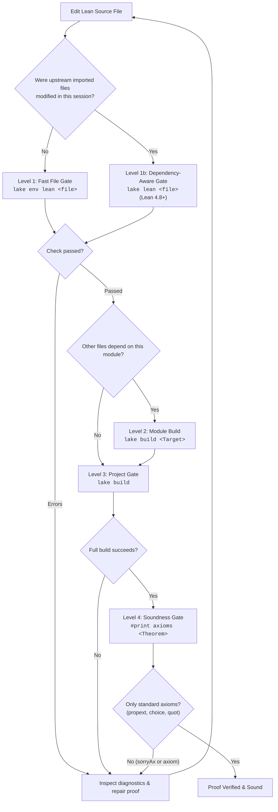

# Lean 4 CLI and Lake Build Management

This skill provides operational workflows and automated tools for managing Lean 4 projects using Lake (the Lean build tool) and Elan (the Lean version manager). It guides agents in fetching pre-compiled Mathlib caches, executing fast file-level type checks, running incremental or full project builds, auditing proof soundness via `#print axioms`, and parsing compiler diagnostics into structured JSON.

---

## 0. Environment & Version Compatibility

| Component         | Target / Supported          | Verified / Tested Version             | Notes                                            |
| :---------------- | :-------------------------- | :------------------------------------ | :----------------------------------------------- |
| **Lean 4 / Lake** | `^4.14.0` (4.14.0+)         | `v4.35.0` (Release, commit `eb6cafb`) | Verified via Lake CLI build & single-file check  |
| **Mathlib**       | Compatible with target Lean | Contemporary with Lean `v4.35.0`      | Uses `lake exe cache get` for pre-built `.olean` |
| **Python**        | `>=3.10`                    | `3.14.x`                              | Required for `scripts/parse_diagnostics.py`      |

### Version-Specific CLI & Build Notes

- **Lake Configuration**: Modern Lean 4 projects use either `lakefile.toml` or `lakefile.lean`. Ensure commands are executed in the project root containing `lean-toolchain`.
- **Diagnostic Formatting**: Modern Lean 4 compiler output is parsed into structured JSON via `scripts/parse_diagnostics.py`.
- **Mathlib Cache Retrieval**: Always invoke `lake exe cache get` before full compilation to avoid building Mathlib from source.

---

## 1. Quick Reference: Common Commands

| Command                   | Purpose                                    | When to Use                                                          |
| :------------------------ | :----------------------------------------- | :------------------------------------------------------------------- |
| `lake exe cache get`      | Fetch Mathlib pre-compiled `.olean` cache  | **Mandatory** on fresh workspace setup or after modifying `lakefile` |
| `lake exe cache get!`     | Force re-download of Mathlib cache         | When `.olean` files are corrupted or type errors occur in Mathlib    |
| `lake env lean <file>`    | Fast single-file type checking             | **Primary verification loop** while actively editing Lean code       |
| `lake build <Module>`     | Build specific library module or target    | After cross-file modifications or adding new imports                 |
| `lake build`              | Full project verification                  | Checkpoint gate or before completing the proof task                  |
| `#print axioms <theorem>` | Audit proof soundness and axioms           | **Final gate** to ensure no `sorryAx` or custom axioms exist         |
| `elan show`               | Show current active toolchain and override | When inspecting Lean version consistency or environment issues       |

---

## 2. Environment and Toolchain Inspection

Lean 4 projects require the correct toolchain version specified in `lean-toolchain`.

### Checking Active Toolchain

```bash
# Check the currently active Lean and Lake toolchains
elan show

# Verify Lean and Lake versions
lean --version
lake --version
```

### Locating the Project Root

Always run `lake` commands from the project root directory (where `lakefile.lean` or `lakefile.toml` exists):

- If `lakefile.lean` or `lakefile.toml` is in the current directory, proceed with standard commands.
- If in a subdirectory, navigate or pass `--dir` if supported. Running commands outside the project root causes `unknown package` errors because Lake cannot set the module search paths (`LEAN_PATH`).

---

## 3. Mathlib Cache Management (Critical)

Mathlib contains hundreds of thousands of lines of formalized mathematics. Compiling Mathlib locally from source takes hours and will consume all CPU cores. **Never run `lake build` in a Mathlib-dependent project without priming the cache first.**

### Fetching the Cache

Execute the cache retrieval command from the project root:

```bash
# Standard command for Mathlib-dependent repositories
lake exe cache get
```

_Note: In newer Lake releases where the cache tool is built-in, `lake cache get` may also be used._

### Corrupted Cache Recovery

If compilation reports unexpected errors inside Mathlib files (e.g., checksum mismatch, invalid olean header, or broken imports):

```bash
# Force re-download of all cache artifacts
lake exe cache get!

# If necessary, clean build artifacts and re-fetch
lake clean
lake exe cache get
```

---

## 4. Verification Ladder: Fast File Gate to Soundness Gate

To maintain fast turnaround times and guarantee strict mathematical rigor, follow this multi-tier verification ladder (from lightest to full verification):

| Tier                               | Tool / Command                              | Dependency Handling                        | Target `.olean` Written | Speed      | Best For                                                      |
| :--------------------------------- | :------------------------------------------ | :----------------------------------------- | :---------------------- | :--------- | :------------------------------------------------------------ |
| **Tier 0: Per-Edit**               | `lean_goal.py` / LSP diagnostics            | In-memory LSP server state                 | No                      | Sub-second | Interactive goal inspection after each tactic line            |
| **Tier 1: Fast File Gate**         | `lake env lean <path/to/File.lean>`         | Reads **existing pre-built `.olean`** only | No                      | Seconds    | Fast syntax/type check when upstream imports are unchanged    |
| **Tier 1b: Dependency-Aware Gate** | `lake lean <path/to/File.lean>` (Lean 4.8+) | **Builds stale imports**, then checks file | No                      | Fast       | File check after editing upstream imports in the same session |
| **Tier 2: Module Build**           | `lake build <Module>`                       | Rebuilds dependencies + target             | **Yes**                 | Moderate   | Writing module `.olean` artifacts for downstream consumers    |
| **Tier 3: Project Gate**           | `lake build`                                | Full workspace build graph                 | **Yes**                 | Minutes    | Pre-commit checkpoint and whole-project validation            |
| **Tier 4: Soundness Gate**         | `#print axioms <Theorem>`                   | Kernel check on environment                | N/A                     | Sub-second | Mandatory audit: eliminate `sorryAx` and synthetic axioms     |



### Level 1: Fast File Gate (`lake env lean <file>`)

- **Command**: `lake env lean <path/to/File.lean>`
- **Characteristics**: Elaborates the single source file against the currently built import environment. It reads existing `.olean` binaries and **does not rebuild** imported modules.
- **Speed**: Seconds (vs. minutes for `lake build`).
- **Use case**: Run immediately after editing a local theorem or proof step when upstream imported files have not changed.

### The Stale `.olean` Cache Trap (File Gate Scope)

> [!WARNING]
> `lake env lean <File.lean>` elaborates against the **compiled `.olean` binaries** of imported modules, NOT their raw source code.
> If an imported module was edited in the same session without being recompiled, the file gate can produce:
>
> 1. **False Pass**: The file gate succeeds because it reads the old `.olean` where a modified or removed upstream definition still exists. The failure only surfaces later during full `lake build`.
> 2. **False Failure**: The file gate fails because it cannot see a new lemma or signature change made in the upstream `.lean` source file, leading to confusion and unnecessary debugging.

#### Recovery Protocols for Cross-File Edits

When editing across multiple files or modifying upstream dependencies, choose one of these two recovery paths:

1. **Path A (`lake lean <file>`, Recommended, Lean 4.8+)**:
   ```bash
   lake lean path/to/File.lean
   ```
   `lake lean` is dependency-aware: it automatically recompiles any modified upstream imports first, then elaborates the target file. Crucially, it does **not** write the target file's own `.olean`, keeping the check fast and avoiding artifact pollution if the file is later rolled back. _(Note: On Lean < 4.8, `lake lean` is not available; use Path B instead.)_
2. **Path B (Explicit Rebuild)**:
   Rebuild the modified dependency first, then run `lake env lean`:
   ```bash
   lake build "MathProof.Data.UpstreamModule" -q --log-level=info
   lake env lean path/to/DownstreamFile.lean
   ```

### Level 2: Incremental Module Build (`lake build <Module>`)

- **Command**: `lake build MathProof.MyModule -q --log-level=info`
- **Characteristics**: Compiles the target module and writes its `.olean` file to disk so downstream modules can consume it.
- **Use case**: When another file in the project depends on changes made in the current file.

#### Module Path Conversion & Escaping Rules (`«...»`)

When targeting a specific module with `lake build`, file paths are converted to dot-separated Lean hierarchical identifiers (`/` → `.`, omitting `.lean`):
`MathProof/Algebra/Basic.lean` → `MathProof.Algebra.Basic`

**Critical: Handling Hyphens and Non-Standard Directory/File Names**:
Lean 4 identifiers follow standard language grammar: hyphens (`-`) are parsed as minus/subtraction operators, and identifiers cannot start with digits or contain special punctuation. If a directory or file in the path contains a hyphen (e.g. `my-submodule`), running `lake build` with a plain string will fail with an `unknown target` error:

- ❌ **Fails**: `lake build MathProof.Data.my-submodule.Basic` (Lake parses `-` as an operator)
- ✅ **Correct (Escaped with French Quotes `«...»`)**:
  ```bash
  lake build "MathProof.Data.«my-submodule».Basic" -q --log-level=info
  ```

> [!TIP]
> In Lean 4, enclosing any string within guillemets (`«` and `»`, French quotation marks) escapes it as a valid atomic identifier (e.g., `«my-submodule»`, `«123-custom»`). In shell environments (bash/zsh), always wrap the full target string in double quotes (`"..."`) or single quotes to prevent the shell from misinterpreting special characters.

### Level 3: Project Gate (`lake build`)

- **Command**: `lake build` (or `lake build -q --log-level=info` to reduce output tokens)
- **Characteristics**: Compiles all targets across the workspace, verifies inter-module consistency, and executes linters if configured.
- **Use case**: Checkpoint gate before considering work finished or handing off a completed proof.

> [!NOTE]
> **Beware of the `[N/M]` Progress Counter**:
> Lake dynamically discovers dependencies during compilation, causing the denominator $M$ to increase mid-build (e.g., jumping from `[120/150]` to `[120/7800]`). The fraction is not a linear percentage estimate; gauge timeouts and progress by wall-clock time and active compiler output rather than the step count.

### Level 4: Soundness Gate (`#print axioms <Theorem>`)

- **Command**: `#print axioms <TheoremName>` (evaluated at the bottom of the file or via stdin)
- **Characteristics**: Verifies that the completed proof depends strictly on Lean 4 / Mathlib's legitimate foundation and contains no illicit shortcuts or unproven premises.
- **Use case**: **Mandatory** before concluding any formalization task.

---

## 5. Soundness & Axiom Verification (`#print axioms`)

A proof that compiles cleanly can still be mathematically unsound if it inadvertently depends on unresolved `sorry` statements or synthetic axioms introduced during experimentation.

### Standard vs. Illicit Axioms

| Axiom Class                | Specific Axioms                                                                         | Assessment                                                        |
| :------------------------- | :-------------------------------------------------------------------------------------- | :---------------------------------------------------------------- |
| **Standard Mathlib Found** | `propext`<br/>`Classical.choice`<br/>`Quot.sound` / `quot.sound`                        | **ACCEPTABLE**: Foundation of classical mathematics in Lean 4.    |
| **Residual Sorry**         | `sorryAx`                                                                               | **STRICTLY FORBIDDEN**: An unproven `sorry` remains in the proof. |
| **Custom / Synthetic**     | Any identifier declared via `axiom ...` (e.g. `my_axiom`, `unproved_helper_hypothesis`) | **STRICTLY FORBIDDEN**: Proof cheats by postulating claims.       |

### How to Run Axiom Audits

#### Method 1: Inline Verification (Recommended for Quick Checks)

Temporarily append `#print axioms <TheoremName>` to the bottom of the `.lean` file and run:

```bash
lake env lean path/to/File.lean
```

**Example Output (Sound Proof):**

```text
'my_theorem' depends on axioms: [propext, Classical.choice, Quot.sound]
```

If you see `sorryAx` or any custom identifier, the proof is **not complete**. Immediately remove the temporary `#print axioms` line after inspection.

#### Method 2: Stdin One-Liner (No File Modification)

Run without editing the source file:

```bash
lake env lean --stdin <<EOF
import MyProject.MyModule
#print axioms MyProject.MyModule.my_theorem
EOF
```

For full details on handling private declarations, namespace scope stacks, eliminating synthetic axioms, and `native_decide` / `Lean.ofReduceBool` caveats, consult the comprehensive guide:

- [Soundness and Axiom Audit Guide](references/soundness_and_axiom_audit.md)

---

## 6. Structured Diagnostics Parsing (`parse_diagnostics.py`)

The skill bundles `scripts/parse_diagnostics.py`, a zero-dependency script using only the Python standard library. It parses console outputs from `lake` and `lean` (including multi-line errors and ANSI color sequences) and returns a structured JSON payload.

### Usage Options

#### Option A: Direct Command Execution (`--run`)

Automatically runs the command, captures stdout/stderr, and parses output:

```bash
python3 <skill-path>/scripts/parse_diagnostics.py --run "lake env lean MathProof/Basic.lean"
python3 <skill-path>/scripts/parse_diagnostics.py --run "lake build"
```

#### Option B: Pipe Output via Stdin

```bash
lake env lean MathProof/Basic.lean 2>&1 | python3 <skill-path>/scripts/parse_diagnostics.py
```

#### Option C: Parse Existing Log File

```bash
python3 <skill-path>/scripts/parse_diagnostics.py build.log
```

### JSON Output Schema

```json
{
  "success": false,
  "exit_code": 1,
  "error_count": 1,
  "warning_count": 0,
  "info_count": 0,
  "summary": "1 error(s), 0 warning(s), 0 info(s)",
  "diagnostics": [
    {
      "file": "MathProof/Basic.lean",
      "line": 15,
      "column": 4,
      "severity": "error",
      "message": "type mismatch\n  has type\n    Nat\n  but is expected to have type\n    String"
    }
  ]
}
```

### Fields

- `success`: `true` if exit code is 0 and `error_count == 0`.
- `exit_code`: Process return code.
- `error_count`: Number of errors detected.
- `warning_count`: Number of warnings detected.
- `info_count`: Number of informational diagnostics detected.
- `summary`: Short human-readable summary string.
- `diagnostics`: List of structured issues:
  - `file`: Path to the file where the diagnostic occurred (`null` for general lake build errors).
  - `line`: 1-indexed line number (`null` if file-level or general).
  - `column`: 1-indexed column number (`null` if file-level or general).
  - `severity`: `"error"`, `"warning"`, or `"info"`.
  - `message`: Diagnostic message, including multi-line indentation details.
- `prints`: (Optional) List of non-diagnostic top-level command output strings (such as `#print axioms` results, `#check` types, or `#eval` values), cleanly separated from compiler warnings and errors.

### Capturing "Try this:" Suggestions Headlessly

When running suggestion tactics like `simp?`, `exact?`, or `grind?`, the Lean compiler outputs candidate replacements as `info` level diagnostics:

```json
{
  "file": "MathProof/Basic.lean",
  "line": 42,
  "column": 2,
  "severity": "info",
  "message": "Try this: simp only [Nat.add_zero, MulZeroClass.mul_zero]"
}
```

AI agents can parse this JSON via `parse_diagnostics.py`, extract the replacement string following `Try this: `, and programmatically substitute it into the source file without relying on an interactive editor infoview.

---

## 6. Troubleshooting Common CLI Issues

### 1. `unknown package 'Mathlib'`

- **Cause**: The command was executed outside the Lake project root, or `lake env` was omitted.
- **Fix**: Run `pwd` to ensure you are in the directory containing `lakefile.lean` / `lakefile.toml`. Always prefix standalone Lean invocations with `lake env` (e.g., `lake env lean <file>`).

### 2. High CPU Usage / Frozen Process during `lake build`

- **Cause**: Mathlib cache was not fetched; Lake is compiling thousands of Mathlib files from source.
- **Fix**: Interrupt the process (`Ctrl+C` or kill process). Run `lake exe cache get` first, then resume building.

### 3. `failed to fetch cache` or Network Timeout

- **Cause**: Network disruption or temporary GitHub release download failure.
- **Fix**: Re-run with `lake exe cache get!`. Check internet connectivity.

### 4. Lean Version Incompatibility

- **Cause**: The current `elan` toolchain does not match `lean-toolchain`.
- **Fix**: Run `elan which lean` or `elan override set $(cat lean-toolchain)`.
