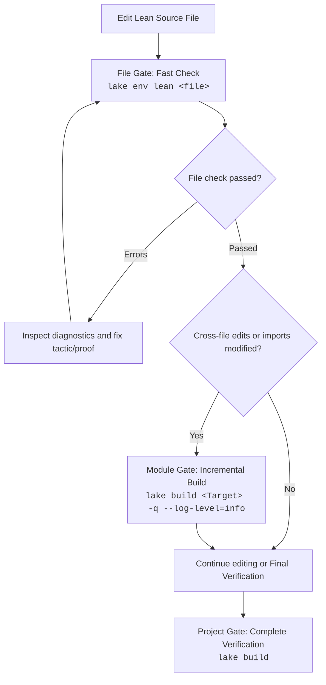

# Lean 4 CLI and Lake Build Management

This skill provides operational workflows and automated tools for managing Lean 4 projects using Lake (the Lean build tool) and Elan (the Lean version manager). It guides agents in fetching pre-compiled Mathlib caches, executing fast file-level type checks, running incremental or full project builds, and parsing compiler diagnostics into structured JSON.

---

## 1. Quick Reference: Common Commands

| Command                | Purpose                                    | When to Use                                                          |
| :--------------------- | :----------------------------------------- | :------------------------------------------------------------------- |
| `lake exe cache get`   | Fetch Mathlib pre-compiled `.olean` cache  | **Mandatory** on fresh workspace setup or after modifying `lakefile` |
| `lake exe cache get!`  | Force re-download of Mathlib cache         | When `.olean` files are corrupted or type errors occur in Mathlib    |
| `lake env lean <file>` | Fast single-file type checking             | **Primary verification loop** while actively editing Lean code       |
| `lake build <Module>`  | Build specific library module or target    | After cross-file modifications or adding new imports                 |
| `lake build`           | Full project verification                  | Checkpoint gate or before completing the proof task                  |
| `elan show`            | Show current active toolchain and override | When inspecting Lean version consistency or environment issues       |

---

## 2. Environment and Toolchain Inspection

Lean 4 projects require the correct toolchain version specified in `lean-toolchain`.

### Checking Active Toolchain

```bash
# Check the currently active Lean and Lake toolchains
elan show

# Verify Lean and Lake versions
lean --version
lake --version
```

### Locating the Project Root

Always run `lake` commands from the project root directory (where `lakefile.lean` or `lakefile.toml` exists):

- If `lakefile.lean` or `lakefile.toml` is in the current directory, proceed with standard commands.
- If in a subdirectory, navigate or pass `--dir` if supported. Running commands outside the project root causes `unknown package` errors because Lake cannot set the module search paths (`LEAN_PATH`).

---

## 3. Mathlib Cache Management (Critical)

Mathlib contains hundreds of thousands of lines of formalized mathematics. Compiling Mathlib locally from source takes hours and will consume all CPU cores. **Never run `lake build` in a Mathlib-dependent project without priming the cache first.**

### Fetching the Cache

Execute the cache retrieval command from the project root:

```bash
# Standard command for Mathlib-dependent repositories
lake exe cache get
```

_Note: In newer Lake releases where the cache tool is built-in, `lake cache get` may also be used._

### Corrupted Cache Recovery

If compilation reports unexpected errors inside Mathlib files (e.g., checksum mismatch, invalid olean header, or broken imports):

```bash
# Force re-download of all cache artifacts
lake exe cache get!

# If necessary, clean build artifacts and re-fetch
lake clean
lake exe cache get
```

---

## 4. Verification Ladder: Fast File Gate vs. Project Gate

To maintain fast turnaround times and avoid burning tokens and computational resources, follow this verification ladder:



### Level 1: Fast File Gate (`lake env lean <file>`)

- **Command**: `lake env lean <path/to/File.lean>`
- **Characteristics**: Evaluates the specified file in the environment configured by Lake. It uses existing `.olean` binaries of imported modules and **does not** trigger recompilation of dependencies.
- **Speed**: Seconds (vs. minutes for `lake build`).
- **Use case**: Run this immediately after editing a theorem or proof step.

### Level 2: Incremental Module Build (`lake build <Module>`)

- **Command**: `lake build MathProof.MyModule -q --log-level=info`
- **Characteristics**: Compiles the target module and updates its `.olean` file.
- **Use case**: When another file in the project depends on changes made in the current file.

#### Module Path Conversion & Escaping Rules (`«...»`)

When targeting a specific module with `lake build`, file paths are converted to dot-separated Lean hierarchical identifiers (`/` → `.`, omitting `.lean`):
`MathProof/Algebra/Basic.lean` → `MathProof.Algebra.Basic`

**Critical: Handling Hyphens and Non-Standard Directory/File Names**:
Lean 4 identifiers follow standard language grammar: hyphens (`-`) are parsed as minus/subtraction operators, and identifiers cannot start with digits or contain special punctuation. If a directory or file in the path contains a hyphen (e.g. `my-submodule`), running `lake build` with a plain string will fail with an `unknown target` error:

- ❌ **Fails**: `lake build MathProof.Data.my-submodule.Basic` (Lake parses `-` as an operator)
- ✅ **Correct (Escaped with French Quotes `«...»`)**:
  ```bash
  lake build "MathProof.Data.«my-submodule».Basic" -q --log-level=info
  ```

> [!TIP]
> In Lean 4, enclosing any string within guillemets (`«` and `»`, French quotation marks) escapes it as a valid atomic identifier (e.g., `«my-submodule»`, `«123-custom»`). In shell environments (bash/zsh), always wrap the full target string in double quotes (`"..."`) or single quotes to prevent the shell from misinterpreting special characters.

### Level 3: Project Gate (`lake build`)

- **Command**: `lake build` (or `lake build -q --log-level=info` to reduce output tokens)
- **Characteristics**: Compiles all targets, verifies consistency, and executes linters if configured.
- **Use case**: Final verification gate before committing or finishing a task.

---

## 5. Structured Diagnostics Parsing (`parse_diagnostics.py`)

The skill bundles `scripts/parse_diagnostics.py`, a zero-dependency script using only the Python standard library. It parses console outputs from `lake` and `lean` (including multi-line errors and ANSI color sequences) and returns a structured JSON payload.

### Usage Options

#### Option A: Direct Command Execution (`--run`)

Automatically runs the command, captures stdout/stderr, and parses output:

```bash
python3 <skill-path>/scripts/parse_diagnostics.py --run "lake env lean MathProof/Basic.lean"
python3 <skill-path>/scripts/parse_diagnostics.py --run "lake build"
```

#### Option B: Pipe Output via Stdin

```bash
lake env lean MathProof/Basic.lean 2>&1 | python3 <skill-path>/scripts/parse_diagnostics.py
```

#### Option C: Parse Existing Log File

```bash
python3 <skill-path>/scripts/parse_diagnostics.py build.log
```

### JSON Output Schema

```json
{
  "success": false,
  "exit_code": 1,
  "error_count": 1,
  "warning_count": 0,
  "info_count": 0,
  "summary": "1 error(s), 0 warning(s), 0 info(s)",
  "diagnostics": [
    {
      "file": "MathProof/Basic.lean",
      "line": 15,
      "column": 4,
      "severity": "error",
      "message": "type mismatch\n  has type\n    Nat\n  but is expected to have type\n    String"
    }
  ]
}
```

### Fields

- `success`: `true` if exit code is 0 and `error_count == 0`.
- `exit_code`: Process return code.
- `error_count`: Number of errors detected.
- `warning_count`: Number of warnings detected.
- `info_count`: Number of informational diagnostics detected.
- `summary`: Short human-readable summary string.
- `diagnostics`: List of structured issues:
  - `file`: Path to the file where the diagnostic occurred (`null` for general lake build errors).
  - `line`: 1-indexed line number (`null` if file-level or general).
  - `column`: 1-indexed column number (`null` if file-level or general).
  - `severity`: `"error"`, `"warning"`, or `"info"`.
  - `message`: Diagnostic message, including multi-line indentation details.

---

## 6. Troubleshooting Common CLI Issues

### 1. `unknown package 'Mathlib'`

- **Cause**: The command was executed outside the Lake project root, or `lake env` was omitted.
- **Fix**: Run `pwd` to ensure you are in the directory containing `lakefile.lean` / `lakefile.toml`. Always prefix standalone Lean invocations with `lake env` (e.g., `lake env lean <file>`).

### 2. High CPU Usage / Frozen Process during `lake build`

- **Cause**: Mathlib cache was not fetched; Lake is compiling thousands of Mathlib files from source.
- **Fix**: Interrupt the process (`Ctrl+C` or kill process). Run `lake exe cache get` first, then resume building.

### 3. `failed to fetch cache` or Network Timeout

- **Cause**: Network disruption or temporary GitHub release download failure.
- **Fix**: Re-run with `lake exe cache get!`. Check internet connectivity.

### 4. Lean Version Incompatibility

- **Cause**: The current `elan` toolchain does not match `lean-toolchain`.
- **Fix**: Run `elan which lean` or `elan override set $(cat lean-toolchain)`.
