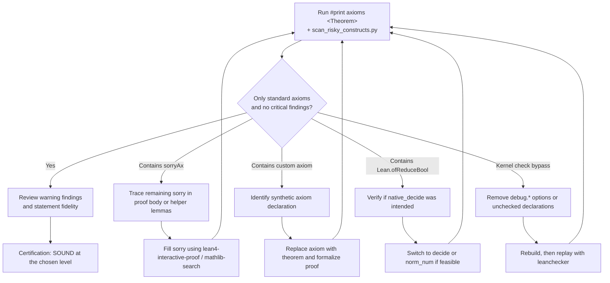

# Soundness and Axiom Audit Guide

In formal mathematics with Lean 4, a proof is not complete merely because `lake build` succeeds. An agent or developer can inadvertently introduce shortcuts—such as leaving an unresolved `sorry` (which introduces `sorryAx`), postulating custom `axiom` declarations, or relying on code evaluation axioms like `Lean.ofReduceBool`.

`#print axioms` catches those shortcuts, but it is only one layer. It cannot tell you whether the theorem **states what you think it states**, whether custom metaprograms bypassed the elaborator, whether the environment was manipulated, or whether the kernel that accepted the proof has known bugs.

This guide establishes the protocols for auditing the **soundness** of completed proofs, from the axiom check up to independent kernel replay:

| Level | Check                                    | What it establishes                                                             | Section |
| :---- | :--------------------------------------- | :------------------------------------------------------------------------------ | :------ |
| **1** | `lake build` succeeds                    | The build toolchain's elaborator and kernel accepted every declaration          | —       |
| **2** | `#print axioms <Theorem>`                | No `sorryAx`, custom axioms, or native-evaluation axioms in the dependency cone | §2      |
| **3** | Static scan (`scan_risky_constructs.py`) | Lists elaborator bypasses, environment hacking and global notation to review    | §5      |
| **4** | Statement fidelity review                | The formal statement means the intended mathematical claim                      | §6      |
| **5** | Kernel replay (`leanchecker`)            | The compiled `.olean` declarations re-check in a clean environment              | §7      |
| **6** | Challenge/Solution check (Comparator)    | The statement is fixed independently of the proof and judged by several kernels | §8      |

Levels 1–2 are mandatory for every task. Apply levels 3–4 whenever the code was not written entirely by you in this session (another agent, a contributor, an external submission). Levels 5–6 are for high-stakes or untrusted results.

---

## 1. Axiom Taxonomy in Lean 4 and Mathlib

Lean 4 is based on the Calculus of Inductive Constructions (CIC). Mathlib accepts a minimal, standard set of classical axioms:

| Axiom                            | Full Identifier                            | Mathematical Role                                      | Status in Mathlib                                                            |
| :------------------------------- | :----------------------------------------- | :----------------------------------------------------- | :--------------------------------------------------------------------------- |
| **Propositional Extensionality** | `propext`                                  | $(P \leftrightarrow Q) \to P = Q$                      | **Standard (Acceptable)**                                                    |
| **Axiom of Choice**              | `Classical.choice`                         | Choice function for non-empty types                    | **Standard (Acceptable)**                                                    |
| **Quotient Soundness**           | `Quot.sound` / `quot.sound`                | Equivalence classes definition                         | **Standard (Acceptable)**                                                    |
| **Native Evaluation**            | `Lean.ofReduceBool` / `Lean.trustCompiler` | Added when using `native_decide` (trusts compiler/C++) | **Restricted**: Requires explicit user consent; avoid in foundational proofs |
| **Residual Sorry**               | `sorryAx`                                  | Synthetic axiom introduced by `sorry` or `admit`       | **STRICTLY FORBIDDEN**                                                       |
| **Synthetic Axiom**              | Any user-defined `axiom`                   | Postulated unproven facts                              | **STRICTLY FORBIDDEN**                                                       |

> [!CAUTION]
> **The `native_decide` Hazard**: While `decide` evaluates computations strictly inside the trusted Lean 4 kernel, `native_decide` (a synonym for `decide +native`) evaluates compiled executable code and adds the axiom `Lean.ofReduceBool`. In pure mathematical verification, prefer `decide` or `norm_num`. Only use `native_decide` if dealing with large combinatorial computations where kernel evaluation times out, and always declare this trade-off explicitly.

---

## 2. Auditing Axioms with `#print axioms`

Lean 4 provides the built-in command `#print axioms <declarationName>` to inspect the transitive closure of all axioms used in a proof.

### Method A: Stdin One-Liner (Preferred — Non-Destructive)

To audit a theorem without modifying your repository source files, pipe an ephemeral command into `lake env lean`:

```bash
# Template:
lake env lean --stdin <<EOF
import MyProject.MyModule
#print axioms MyProject.MyModule.my_theorem
EOF
```

**Clean / Sound Output:**

```text
'MyProject.MyModule.my_theorem' depends on axioms: [propext, Classical.choice, Quot.sound]
```

**Unsound / Incomplete Output:**

```text
'MyProject.MyModule.my_theorem' depends on axioms: [sorryAx, propext]
```

_(If `sorryAx` appears, the proof is not mathematically sound)._

> [!TIP]
> **Structured Audit via `parse_diagnostics.py`**:
> When piped through `parse_diagnostics.py`, axiom audit outputs are automatically recognized and isolated into the `"prints"` JSON array, preventing them from being swallowed into preceding compiler warnings (such as `declaration uses 'sorry'`):
>
> ```bash
> lake env lean --stdin <<EOF 2>&1 | python3 <skill-path>/scripts/parse_diagnostics.py
> import MyProject.MyModule
> #print axioms MyProject.MyModule.my_theorem
> EOF
> ```

### Method B: Inline Inspection (Local Debugging)

Temporarily append the inspection at the bottom of the active `.lean` file:

```lean
-- Bottom of File.lean
#print axioms my_theorem
```

Run file evaluation:

```bash
lake env lean path/to/File.lean
```

> [!IMPORTANT]
> Always remove the `#print axioms` line before committing, as trailing commands can produce noise in compiler diagnostics.

---

## 3. Handling Namespaces and Private Declarations

### 1. Fully-Qualified Names

If the declaration is inside a namespace, you must provide its fully-qualified identifier:

```lean
namespace Geometry.Euclidean

theorem pythagoras : ... := by ...

end Geometry.Euclidean

#print axioms Geometry.Euclidean.pythagoras
```

### 2. Private Declarations

Declarations marked with `private` are not exported outside their defining file module. To audit a `private` theorem, `#print axioms` **must** be evaluated inside the same file at a line subsequent to the declaration.

---

## 4. What `#print axioms` Cannot See

A clean axiom list proves only that the kernel-accepted proof term depends on no extra axioms. The following gaps remain:

| Gap                        | Example                                                                                                   | Detected by `#print axioms`? | Where to check |
| :------------------------- | :-------------------------------------------------------------------------------------------------------- | :--------------------------- | :------------- |
| **Wrong statement**        | Theorem proves a weaker claim, a junk-value edge case, or a redefined notion with the same name           | No                           | §6, §8         |
| **Global notation**        | A non-`local` `notation` / `infix` changes what a statement means when read                               | No                           | §5, §6         |
| **Elaborator bypass**      | A custom tactic assigns the goal without the elaborator checking the term's type                          | No (kernel still checks)     | §5, §7         |
| **Environment hacking**    | `addDecl` / `modifyEnv` / `run_cmd` add or alter declarations; `debug.skipKernelTC` skips kernel checking | Partially                    | §5, §7         |
| **Kernel or runtime bugs** | The build toolchain predates a kernel soundness fix                                                       | No                           | §7, §8         |
| **Untrusted artifacts**    | Prebuilt `.olean` files from a shared cache were produced by someone else's machine                       | No                           | §7, §8         |

### Elaborator Bypass Pattern

The following tactic is legal Lean and looks like `exact`, but it never checks that the elaborated term has the goal's type:

```lean
import Lean
open Lean Elab Tactic Meta

-- ⚠️ RED FLAG: assigns the goal directly; no `isDefEq` check against the goal type
elab "kexact " e:term : tactic => withMainContext do
  let g ← getMainGoal
  let v ← Term.elabTermAndSynthesize e none
  g.assign (← instantiateMVars v)
```

- **Is it unsound?** Not by itself. The kernel type-checks every declaration that is added to the environment, so an ill-typed proof is still rejected at that point.
- **Why flag it?** The proof now depends on the kernel alone. The elaborator's checks, readable error messages and position information are lost, and a reviewer cannot rely on "it elaborated" as evidence. Combined with a kernel bug, this is exactly the path an adversarial proof would take.
- **The goal-closing helpers do not compare types either.** `MVarId.checkedAssign` runs only an occurs check, and `closeMainGoal` rejects unassigned metavariables before calling it, so a variant of `kexact` built on either one is just as unchecked. `closeMainGoalUsing` leaves the type check to its callback: `fun type _ => elabTermEnsuringType e type` performs it, `fun _ _ => elabTerm e none` does not.
- **Action**: Treat any direct `MVarId.assign` or `MVarId.checkedAssign`, call to `closeMainGoal` or `closeMainGoalUsing`, `run_tac` block that assigns goals, or command that copies declarations via `addDecl` as a mandatory review item, and confirm the result with kernel replay (§7).
- **Find the uses, not only the definition.** The definition is one line in one file, but the bypass takes effect wherever the tactic is used, often through small macros (`macro "kc% " e:term : term => `((by kexact $e))`). In one large submission, two such tactics, each defined once, were used 282 times directly and 624 more times through 12 macros built on them, in 78 files. `scan_risky_constructs.py` lists these uses (§5, "Tracing Custom Syntax to Its Uses").

> [!NOTE]
> Legitimate projects also use these APIs, for example to register names on a library-suggestion deny list via `run_cmd Lean.modifyEnv ...`. The goal of the audit is not to forbid metaprogramming, but to make every use of it visible and explained.

---

## 5. Static Scan with `scan_risky_constructs.py`

The skill bundles `scripts/scan_risky_constructs.py`, a zero-dependency script (Python standard library only) that searches Lean sources for constructs that extend the trust base. Comments, docstrings and string literals are blanked out before matching, so words inside them do not produce false positives.

### Usage

```bash
# Scan the current project (skips .lake/ and .git/)
python3 <skill-path>/scripts/scan_risky_constructs.py

# Scan specific directories or files
python3 <skill-path>/scripts/scan_risky_constructs.py src/ MathProof/Basic.lean

# Exclude a challenge file that intentionally contains `sorry`
python3 <skill-path>/scripts/scan_risky_constructs.py src/ --exclude 'src/Challenge.lean'

# Fail on warnings too (e.g. for CI on untrusted contributions)
python3 <skill-path>/scripts/scan_risky_constructs.py src/ --fail-on warning

# Full structured report for agent pipelines
python3 <skill-path>/scripts/scan_risky_constructs.py src/ --json

# Show the rule catalog
python3 <skill-path>/scripts/scan_risky_constructs.py --list-rules
```

| Option               | Meaning                                                                                  |
| :------------------- | :--------------------------------------------------------------------------------------- |
| `paths`              | Files or directories to scan (default: `.`). `.lake/` and `.git/` are always skipped.    |
| `--exclude GLOB`     | Skip matching paths (repeatable).                                                        |
| `--ignore-rule RULE` | Disable a rule by ID (repeatable).                                                       |
| `--fail-on LEVEL`    | `critical` (default), `warning`, `info`, or `never`.                                     |
| `--max-findings N`   | Findings printed in text mode (default `200`, `0` = all). JSON always lists all.         |
| `--jobs N`           | Worker processes (default `0` = auto: one per CPU for 256 or more files, otherwise `1`). |
| `--json`             | Print the full report as JSON.                                                           |
| `--list-rules`       | Print the rule catalog and exit.                                                         |

**Scale**: a project of 175,187 files (about 1 GB of source) is scanned in 10 to 20 seconds with automatic parallelism on 12 cores, using about 130 MB of memory. The report does not depend on `--jobs`.

**Exit codes**: `0` = no finding at or above `--fail-on`; `1` = at least one such finding; `2` = usage error (unknown rule, missing path, no `.lean` files).

### Rule Catalog

| Severity     | Rule ID                    | Detects                                                                                                          |
| :----------- | :------------------------- | :--------------------------------------------------------------------------------------------------------------- |
| **critical** | `sorry`, `admit`           | Unproven placeholders (`sorryAx`)                                                                                |
| **critical** | `sorry-internals`          | `sorryAx`, `mkSorry`, `admitGoal` used directly (e.g. hidden inside a custom tactic)                             |
| **critical** | `axiom-declaration`        | User-declared `axiom`                                                                                            |
| **critical** | `native-evaluation`        | `native_decide`, `decide +native`, `Lean.ofReduceBool`, `Lean.ofReduceNat`, `Lean.trustCompiler`                 |
| **critical** | `kernel-check-bypass`      | `set_option debug.*` (e.g. `debug.skipKernelTC`), `addDeclWithoutChecking`                                       |
| **warning**  | `goal-assignment`          | `.assign`, `.checkedAssign`, `assignExprMVar`, `closeMainGoal`, `closeMainGoalUsing`: possible elaborator bypass |
| **warning**  | `metaprogram-evaluation`   | `run_tac`, `run_cmd`, `run_elab`, `run_meta`, `#eval`                                                            |
| **warning**  | `environment-modification` | `addDecl`, `addAndCompile`, `modifyEnv`, `setEnv`                                                                |
| **warning**  | `initializer`              | `initialize` / `builtin_initialize` (runs on import)                                                             |
| **warning**  | `unsafe-code`              | `unsafe`, `unsafeCast`, `unsafeIO`, `allowUnsafeReducibility`                                                    |
| **warning**  | `compiler-trust`           | `implemented_by`, `extern`                                                                                       |
| **warning**  | `sat-certificate`          | `bv_decide`, `bv_check` (confirm the axiom list; reliance on native evaluation depends on the version)           |
| **warning**  | `global-notation`          | `notation` / `infix` / `prefix` / `postfix` without `local` or `scoped`                                          |
| **warning**  | `io-side-effect`           | `IO.Process`, `IO.FS`, `IO.getEnv` (processes, files, environment variables during elaboration)                  |
| **info**     | `lean-meta-import`         | `import Lean` / `import Lean.*` (metaprogramming API available)                                                  |
| **info**     | `syntax-extension`         | `macro`, `macro_rules`, `syntax`, `elab`, `elab_rules`, `declare_syntax_cat`                                     |
| **info**     | `kernel-defeq-call`        | `Kernel.isDefEq`, `Kernel.whnf` called from a metaprogram (often decides whether to assign a goal)               |
| **info**     | `opaque-declaration`       | `opaque` constants                                                                                               |
| _as source_  | `<rule>-via-syntax`        | A use of custom syntax whose definition contains `<rule>` (see below)                                            |

The `<rule>-via-syntax` rules exist for `sorry`, `admit`, `sorry-internals`, `native-evaluation`, `kernel-check-bypass` (all **critical**), `goal-assignment` and `environment-modification` (**warning**). Each has the severity of its source rule.

**`goal-assignment` is not exhaustive.** It matches only the names listed above, and other metaprogramming APIs can change a goal without checking it. For example, `MVarId.replaceTargetDefEq` replaces the target without checking definitional equality:

```lean
import Lean

open Lean Elab Tactic Meta

-- ⚠️ the scan reports no `goal-assignment` for this tactic or its use
elab "to_true" : tactic => do
  let g ← (← getMainGoal).replaceTargetDefEq (mkConst ``True)
  replaceMainGoal [g]

-- the tactic script runs without complaint, then the kernel rejects the theorem
theorem wrong : False := by
  to_true
  trivial
```

A result without `goal-assignment` findings therefore does not show that every tactic checks its goals. For the correctness of the proofs, rely on the kernel: build with no `kernel-check-bypass` finding, and replay the declarations (§7).

### Tracing Custom Syntax to Its Uses

A construct hidden inside a custom tactic, term or command takes effect where that syntax is **used**, under a name the other rules do not know. The scanner therefore runs a second pass:

1. **Definitions**: every `elab`, `macro`, `syntax`, `elab_rules` and `macro_rules` is read together with its indented body. Its **atom** is the leading string of the definition (`"kexact "` → `kexact`) or, for `elab_rules` / `macro_rules`, the head of each match pattern (``| `(tactic| decide) =>`` → `decide`).
2. **Taint**: a definition is tainted if its body contains a traced construct, calls a `def` of the same file that contains one (transitively), or uses the atom of another tainted definition. The last step repeats until nothing changes, so chains such as `coef_cases` → `ksub` → `kexact` are followed across files.
3. **Uses**: every occurrence of a tainted atom outside its own definition, ignoring comments and strings, is reported as `<rule>-via-syntax` with `via` (the atom) and `defined_at`.

```text
Custom syntax hiding traced constructs (atom: constructs; definitions; uses):
  `kc%`: goal-assignment; Tac/Exact.lean:11; 1 use(s)
  `kexact`: goal-assignment; Tac/Exact.lean:5; 2 use(s)

Findings:
  Use/A.lean:4:25: warning: [goal-assignment-via-syntax] theorem t1 : True := by kexact trivial  (via `kexact`, defined at Tac/Exact.lean:5)
```

- **Overriding existing syntax is caught too.** `macro_rules | `(tactic| decide) => `(tactic| sorry)` makes every later `decide` a `sorry`; each such `decide` is reported as `sorry-via-syntax` (critical).
- **Limits**: atoms are matched by name across all scanned files, so a harmless `local` macro that reuses the name of a tainted one is reported as well (a false positive, never a miss). Helpers are followed only within the same file, and syntax produced by code generation or by syntax defined outside the scanned paths (e.g. in a dependency) is not traced.

### JSON Output Schema

```json
{
  "passed": false,
  "fail_on": "critical",
  "scanned_files": 15,
  "counts": { "critical": 1, "warning": 2, "info": 2 },
  "summary": "15 file(s) scanned: 1 critical, 2 warning(s), 2 info(s)",
  "census": [
    {
      "rule": "goal-assignment",
      "severity": "warning",
      "count": 1,
      "file_count": 1,
      "description": "Assigns a metavariable directly. ..."
    }
  ],
  "traced_syntax": [
    {
      "atom": "kexact",
      "sources": ["goal-assignment"],
      "defined_at": ["MathProof/Tactics.lean:5"],
      "use_count": 1
    }
  ],
  "findings": [
    {
      "file": "MathProof/Tactics.lean",
      "line": 8,
      "column": 3,
      "rule": "goal-assignment",
      "severity": "warning",
      "text": "g.assign (← instantiateMVars v)"
    },
    {
      "file": "MathProof/Main.lean",
      "line": 12,
      "column": 25,
      "rule": "goal-assignment-via-syntax",
      "severity": "warning",
      "text": "theorem t1 : True := by kexact trivial",
      "via": "kexact",
      "defined_at": "MathProof/Tactics.lean:5"
    }
  ],
  "unreadable_files": []
}
```

- `census` lists **every** rule, including zero counts, so the report doubles as a reproducible "nothing found" record.
- `traced_syntax` lists each tainted atom with the constructs it hides, its definitions and its number of uses.
- `findings[].text` is the trimmed source line (up to 200 characters). `via` and `defined_at` are present only on `<rule>-via-syntax` findings.

### Triage by Severity

1. **critical**: The proof is incomplete or trusts something beyond the kernel. Eliminate it (§9) or obtain explicit user consent (e.g. a deliberate `native_decide`). A challenge/statement file that intentionally ends in `sorry` should be excluded with `--exclude`, never silently ignored.
2. **warning**: Read every occurrence. Record what each metaprogram does (which declarations it adds, which goals it closes, which names it registers). Confirm the affected theorems with kernel replay (§7).
3. **info**: Inventory only. Read each custom `elab` / `macro` once; most are harmless, but a custom tactic is where an elaborator bypass lives.

Typical `warning` findings and how to read them:

| Finding                                                                                      | Usually                        | What to record                                                                                             |
| :------------------------------------------------------------------------------------------- | :----------------------------- | :--------------------------------------------------------------------------------------------------------- |
| `run_cmd Lean.modifyEnv fun env => Lean.LibrarySuggestions.nameDenyListExt.addEntry env "X"` | Harmless                       | Hides every theorem with a name component `X` from `+suggestions` tactics; adds no declaration             |
| `run_tac ... (fun g => do pure [← g.revertAll])); exact foo`                                 | Harmless                       | Reverts hypotheses, then a normal `exact` checks the term                                                  |
| `run_tac` block that calls `assign` itself                                                   | Elaborator bypass              | Which goal is closed with which term; confirm with kernel replay                                           |
| `elab ... => ... g.assign ...` and its `goal-assignment-via-syntax` uses                     | Elaborator bypass              | The tactic's name, the number of uses (`traced_syntax`), and that the affected theorems pass kernel replay |
| `kernel-defeq-call` next to a goal assignment                                                | Bypass with a kernel pre-check | The tactic accepts a term when the kernel finds it defeq; the elaborator's own check is still skipped      |
| `addDecl` in a custom command and its `environment-modification-via-syntax` uses             | Declarations copied or built   | Which declarations are added under which names, at each use; the kernel checks each added declaration      |

> [!WARNING]
> **A text scan is not a proof.** The scanner works on text, so it can miss constructs produced by macros or code generation, and it can flag harmless identifiers. A clean scan narrows the review; only the kernel checks in §7–§8 establish correctness.

---

## 6. Statement Fidelity Review

The kernel certifies that the proof proves **the formal statement**. Whether the formal statement is the intended mathematics must be checked by reading it. Do this for every primary theorem, before trusting its proof.

### Review Checklist

- [ ] **Definitions come from the trusted library.** The statement uses Mathlib's definitions (e.g. `RiemannHypothesis`, `riemannZeta`, `DirichletCharacter.LFunction`), not project-local look-alikes with the same name in another namespace. Check with `#print` / `#check` and fully-qualified names.
- [ ] **Junk values are excluded.** Mathlib's total functions return conventional values outside their domain (`x / 0 = 0`, `riemannZeta 1` is a junk value, `deriv` of a non-differentiable function is `0`). Check that the hypotheses exclude those points (e.g. `s ≠ 1`), otherwise the statement may be vacuous or false for the wrong reason. See `lean4-mathlib-use` → `junk_values_and_partial_functions.md`.
- [ ] **Numeric literals and division live in the intended type.** `1 / 2` compared with `s.re : ℝ` is real division; the same expression elaborated in `ℕ` is `0`. Hover or `#check` each literal-bearing subterm.
- [ ] **Coercions point the right way.** `((n : ℕ) : ℂ)` versus arithmetic carried out in `ℕ` before the cast (`↑(n - 1)` vs `↑n - 1`).
- [ ] **Quantifier scope and hypothesis direction are correct.** Every `∀` covers what it should (all moduli, all characters, imprimitive ones included); implications are not accidentally reversed.
- [ ] **Exceptional cases match the informal claim.** Trivial zeros, the trivial character at `s = 1`, boundary values: excluded exactly as in the informal statement, no more and no less.
- [ ] **No global notation or instance changes the reading.** Check the `global-notation` findings from §5 and any local instances in scope of the statement.
- [ ] **Scope of the claim is stated.** Record what is _not_ covered (e.g. "Dirichlet L-functions only; Dedekind zeta functions are out of scope").

> [!TIP]
> Write the primary statements in a separate file that imports **only Mathlib** (no project code) and restate the theorems there with `:= by sorry`. If that file compiles, the statement cannot depend on any project-local definition. This file is also the "challenge" input for §8.

---

## 7. Kernel Replay with `leanchecker`

Lean toolchains ship `leanchecker`, which replays the declarations stored in compiled `.olean` files through the kernel:

```bash
# Replay every module whose name starts with MyProject.Main (parallel)
lake env leanchecker MyProject.Main

# Replay one module and all of its imports into a fresh environment
lake env leanchecker --fresh MyProject.Main
```

- **Default mode** replays the declarations of each target module into the environment as it was at the beginning of that module.
- **`--fresh`** replays every constant (imported and local) into an empty environment. It accepts exactly one module and takes far longer, but it does not trust any previously loaded state.
- According to its own documentation, `leanchecker` **"is not an external verifier, simply a tool to detect 'environment hacking'"**: it reuses Lean's own kernel. It catches declarations that entered the environment without being checked (e.g. via `modifyEnv` or `debug.skipKernelTC`), but not bugs in the kernel itself.
- [lean4lean](https://github.com/digama0/lean4lean) is an independent kernel implementation with a matching CLI (`lake env lean4lean --fresh MyProject.Main`), built against the same Lean version as the project.

> [!IMPORTANT]
> **The build toolchain's kernel version matters.** A successful build is evidence from that toolchain's kernel only. If kernel soundness fixes were released after the project's pinned Lean version, a build by that version is limited evidence. Check the Lean release notes for kernel fixes newer than the pinned version and, for high-stakes results, judge the proof with a newer toolchain or independent kernels (§8).

---

## 8. Challenge/Solution Separation with Comparator

For results that must be trusted without trusting the author (external submissions, autonomous agent runs, competition entries), use [Comparator](https://github.com/leanprover/comparator). It checks that a **solution** proves exactly the theorems stated in a **challenge**, using only permitted axioms, and replays the proof with one or more kernels.

### File Layout

```text
src/Challenge.lean      -- imports only Mathlib; definitions + theorems ending in `:= by sorry`
src/Main.lean           -- the solution; same theorem names and statements, with proofs
comparator.json         -- judge configuration
export-targets.txt      -- declarations to export (see Comparator's README)
```

`comparator.json`:

```json
{
  "challenge_module": "Challenge",
  "solution_module": "Main",
  "theorem_names": ["my_main_theorem"],
  "permitted_axioms": ["propext", "Quot.sound", "Classical.choice"],
  "external_kernels": {
    "Lean paranoid": ["leanchecker-paranoid", "--silent", "--from-export"],
    "nanoda": ["nanoda_bin"]
  }
}
```

### Procedure

```bash
# 1. Export the challenge from a clean clone, BEFORE any solution code is compiled.
lake exe mathlib/cache get        # Mathlib's cache only, not prebuilt project artifacts
lake build Challenge
lake env lean4export Challenge -- $(cat export-targets.txt) > challenge.export

# 2. Build and export the solution in a separate clone, inside a sandbox without network.
lake build Main
lake env lean4export Main -- $(cat "$CLEAN/export-targets.txt") > solution.export

# 3. Judge, using the config and challenge export from the clean clone.
lake comparator --config "$CLEAN/comparator.json" \
  --challenge-from-export "$CLEAN/challenge.export" --solution-from-export solution.export
```

- **`lake comparator`** is available in recent Lean releases (4.35+); for older projects, export with the project's toolchain and judge with a newer one, or use the standalone Comparator. The exporter ([lean4export](https://github.com/leanprover/lean4export)) must be built with exactly the project's toolchain, because Lean refuses `.olean` files written by a different Lean build.
- **Compiling untrusted code runs it.** `initialize`, `run_cmd`, `elab` and `#eval` execute during the build. Build untrusted solutions in a sandbox with no network, export the challenge where no solution code was ever compiled, and treat everything the build wrote (including the solution export) as untrusted input.
- **Do not trust shared build caches for verification.** Integrity checks on downloaded `.olean` files prove which bytes were published, not that the proofs are valid. Use a fresh build when the result must be trusted.
- **Independent kernels** listed under `external_kernels` each judge the export; any non-zero exit is a rejection. Some checkers reject valid exports for reasons unrelated to correctness, so test each checker on a small project with the same toolchain before relying on it (see "Checker Compatibility" below).

### Checker Compatibility

`lake comparator --paranoid` runs five external checkers besides Lean's kernel: `leanchecker-paranoid`, `lean4lean`, `nanoda`, `con-leche` and `con-ron`. A non-zero exit from any of them fails the whole run, including a refusal that says nothing about whether the proof is right.

| Checker (Lean `v4.36.0`)         | Known refusal of a valid export                                                                                                                                                                         | Source                                 |
| :------------------------------- | :------------------------------------------------------------------------------------------------------------------------------------------------------------------------------------------------------ | :------------------------------------- |
| `con-leche`, `con-ron`           | A `mutual` block with a **reflexive** member (a constructor argument that is a function into the type, e.g. `lim : (Nat → A) → B → A`). Exit `2`, `declined: in-process model of A: reflexive member A` | Reproduced (`--verified`, 4.36 export) |
| `lean4lean`                      | Every export made by Lean `v4.33.1`: `unknown constant 'Decidable.intro'`, because 4.36 redefined `Decidable` in the core library                                                                       | Reported, not reproduced               |
| `leanchecker-paranoid`, `nanoda` | None known; both accept the reflexive mutual block above                                                                                                                                                | Reproduced                             |

A reflexive inductive **outside** a `mutual` block is accepted by all of them.

- **Find the cause before dropping a checker.** Reproduce the refusal on a small project that has the same feature (here, a mutual reflexive inductive), and confirm that the other kernels accept it.
- **Name the checkers explicitly** in `external_kernels` instead of using `--paranoid` when one checker cannot handle the project, and record in the verification notes which checker was left out and why.
- **Keep at least one independent design.** `leanchecker-paranoid` is a hardened build of Lean's own kernel, so it is not independent of it. Keep `nanoda` (or another independent checker) in the list.
- **Run checkers that read `.olean` files separately**, built with the project's toolchain: `lake env lean4lean --fresh Main` replays the build output instead of the export, so the cross-version refusal above does not apply.
- **Limits**: Comparator compares challenge and solution against the same dependency versions, so it cannot detect a modified dependency. Pin Mathlib to an official tag and verify `lake-manifest.json` against upstream. A passing run still trusts the checkers, Mathlib's definitions, the exporter and the sandbox.

---

## 9. Axiom Elimination Workflow

When an audit reveals non-standard axioms, `sorryAx`, or critical scan findings:



1. **Eliminating `sorryAx`**: Search for `sorry` or `admit` across all dependencies of the theorem. Often a helper lemma defined earlier in the file or imported from a local module still contains a `sorry`. `scan_risky_constructs.py` lists every location at once.
2. **Eliminating Custom Axioms**: If a colleague or past session declared `axiom my_helper : ...`, convert `axiom` to `theorem`, provide a `by sorry` placeholder, and systematically eliminate the `sorry` using Mathlib search and interactive tactics.
3. **Eliminating Kernel-Check Bypasses**: Delete `set_option debug.skipKernelTC` (and other `debug.*` options) and any `addDeclWithoutChecking`, rebuild, and confirm with `leanchecker` that every declaration re-checks.

---

## 10. Verification Checklist

Before marking any formalization task as complete:

- [ ] Has `#print axioms <Theorem>` been executed for every primary mathematical declaration?
- [ ] Is the resulting axiom set a subset of `[propext, Classical.choice, Quot.sound]`?
- [ ] Is the proof completely free of `sorryAx`?
- [ ] If `Lean.ofReduceBool` is present, has the decision to rely on `native_decide` been validated?
- [ ] Have all temporary `#print axioms` commands been cleaned up from source files?

Additionally, for code you did not write entirely yourself in this session:

- [ ] Has `scan_risky_constructs.py` reported no critical findings (with intentional `sorry` files excluded explicitly)?
- [ ] Has every warning finding (goal assignment, environment modification, global notation, ...) been read and explained?
- [ ] Has each primary statement passed the statement fidelity review (§6)?

For high-stakes or untrusted results:

- [ ] Have the compiled modules been replayed with `leanchecker` (and `--fresh` for the main module)?
- [ ] Has the proof been judged against an independently built challenge with Comparator and at least one independent kernel?
- [ ] Have known kernel soundness fixes after the pinned Lean version been considered?
