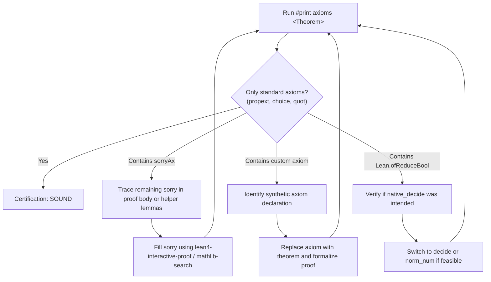

# Soundness and Axiom Audit Guide

In formal mathematics with Lean 4, a proof is not complete merely because `lake build` succeeds. An agent or developer can inadvertently introduce shortcuts—such as leaving an unresolved `sorry` (which introduces `sorryAx`), postulating custom `axiom` declarations, or relying on code evaluation axioms like `Lean.ofReduceBool`.

This guide establishes the protocols for auditing the **soundness** of completed proofs, classifying legitimate vs. illicit axioms, and running automated verification.

---

## 1. Axiom Taxonomy in Lean 4 and Mathlib

Lean 4 is based on the Calculus of Inductive Constructions (CIC). Mathlib accepts a minimal, standard set of classical axioms:

| Axiom                            | Full Identifier             | Mathematical Role                                      | Status in Mathlib                                                            |
| :------------------------------- | :-------------------------- | :----------------------------------------------------- | :--------------------------------------------------------------------------- |
| **Propositional Extensionality** | `propext`                   | $(P \leftrightarrow Q) \to P = Q$                      | **Standard (Acceptable)**                                                    |
| **Axiom of Choice**              | `Classical.choice`          | Choice function for non-empty types                    | **Standard (Acceptable)**                                                    |
| **Quotient Soundness**           | `Quot.sound` / `quot.sound` | Equivalence classes definition                         | **Standard (Acceptable)**                                                    |
| **Native Evaluation**            | `Lean.ofReduceBool`         | Added when using `native_decide` (trusts compiler/C++) | **Restricted**: Requires explicit user consent; avoid in foundational proofs |
| **Residual Sorry**               | `sorryAx`                   | Synthetic axiom introduced by `sorry` or `admit`       | **STRICTLY FORBIDDEN**                                                       |
| **Synthetic Axiom**              | Any user-defined `axiom`    | Postulated unproven facts                              | **STRICTLY FORBIDDEN**                                                       |

> [!CAUTION]
> **The `native_decide` Hazard**: While `decide` evaluates computations strictly inside the trusted Lean 4 kernel, `native_decide` evaluates compiled executable code and adds the axiom `Lean.ofReduceBool`. In pure mathematical verification, prefer `decide` or `norm_num`. Only use `native_decide` if dealing with large combinatorial computations where kernel evaluation times out, and always declare this trade-off explicitly.

---

## 2. Auditing Axioms with `#print axioms`

Lean 4 provides the built-in command `#print axioms <declarationName>` to inspect the transitive closure of all axioms used in a proof.

### Method A: Stdin One-Liner (Preferred — Non-Destructive)

To audit a theorem without modifying your repository source files, pipe an ephemeral command into `lake env lean`:

```bash
# Template:
lake env lean --stdin <<EOF
import MyProject.MyModule
#print axioms MyProject.MyModule.my_theorem
EOF
```

**Clean / Sound Output:**

```text
'MyProject.MyModule.my_theorem' depends on axioms: [propext, Classical.choice, Quot.sound]
```

**Unsound / Incomplete Output:**

```text
'MyProject.MyModule.my_theorem' depends on axioms: [sorryAx, propext]
```

_(If `sorryAx` appears, the proof is not mathematically sound)._

### Method B: Inline Inspection (Local Debugging)

Temporarily append the inspection at the bottom of the active `.lean` file:

```lean
-- Bottom of File.lean
#print axioms my_theorem
```

Run file evaluation:

```bash
lake env lean path/to/File.lean
```

> [!IMPORTANT]
> Always remove the `#print axioms` line before committing, as trailing commands can produce noise in compiler diagnostics.

---

## 3. Handling Namespaces and Private Declarations

### 1. Fully-Qualified Names

If the declaration is inside a namespace, you must provide its fully-qualified identifier:

```lean
namespace Geometry.Euclidean

theorem pythagoras : ... := by ...

end Geometry.Euclidean

#print axioms Geometry.Euclidean.pythagoras
```

### 2. Private Declarations

Declarations marked with `private` are not exported outside their defining file module. To audit a `private` theorem, `#print axioms` **must** be evaluated inside the same file at a line subsequent to the declaration.

---

## 4. Axiom Elimination Workflow

When an audit reveals non-standard axioms or `sorryAx`:



1. **Eliminating `sorryAx`**: Search for `sorry` or `admit` across all dependencies of the theorem. Often a helper lemma defined earlier in the file or imported from a local module still contains a `sorry`.
2. **Eliminating Custom Axioms**: If a colleague or past session declared `axiom my_helper : ...`, convert `axiom` to `theorem`, provide a `by sorry` placeholder, and systematically eliminate the `sorry` using Mathlib search and interactive tactics.

---

## 5. Verification Checklist

Before marking any formalization task as complete:

- [ ] Has `#print axioms <Theorem>` been executed for every primary mathematical declaration?
- [ ] Is the resulting axiom set a subset of `[propext, Classical.choice, Quot.sound]`?
- [ ] Is the proof completely free of `sorryAx`?
- [ ] If `Lean.ofReduceBool` is present, has the decision to rely on `native_decide` been validated?
- [ ] Have all temporary `#print axioms` commands been cleaned up from source files?
