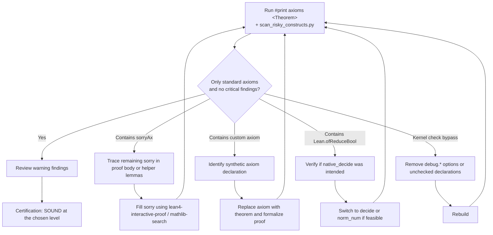

# Soundness and Axiom Audit Guide

In formal mathematics with Lean 4, a proof is not complete merely because `lake build` succeeds. An agent or developer can inadvertently introduce shortcuts—such as leaving an unresolved `sorry` (which introduces `sorryAx`), postulating custom `axiom` declarations, or relying on code evaluation axioms like `Lean.ofReduceBool`.

`#print axioms` catches those shortcuts, but it is only one layer. It cannot tell you whether the theorem **states what you think it states**, whether custom metaprograms bypassed the elaborator, whether the environment was manipulated, or whether the kernel that accepted the proof has known bugs.

This guide establishes the protocols for auditing the **soundness** of completed proofs, from the axiom check up to a static scan of the sources:

| Level | Check                                    | What it establishes                                                             | Section |
| :---- | :--------------------------------------- | :------------------------------------------------------------------------------ | :------ |
| **1** | `lake build` succeeds                    | The build toolchain's elaborator and kernel accepted every declaration          | —       |
| **2** | `#print axioms <Theorem>`                | No `sorryAx`, custom axioms, or native-evaluation axioms in the dependency cone | §2      |
| **3** | Static scan (`scan_risky_constructs.py`) | Lists elaborator bypasses, environment hacking and global notation to review    | §5      |

Levels 1–2 are mandatory for every task. Apply level 3 whenever the code was not written entirely by you in this session (another agent, a contributor, an external submission).

---

## 1. Axiom Taxonomy in Lean 4 and Mathlib

Lean 4 is based on the Calculus of Inductive Constructions (CIC). Mathlib accepts a minimal, standard set of classical axioms:

| Axiom                            | Full Identifier                            | Mathematical Role                                      | Status in Mathlib                                                            |
| :------------------------------- | :----------------------------------------- | :----------------------------------------------------- | :--------------------------------------------------------------------------- |
| **Propositional Extensionality** | `propext`                                  | $(P \leftrightarrow Q) \to P = Q$                      | **Standard (Acceptable)**                                                    |
| **Axiom of Choice**              | `Classical.choice`                         | Choice function for non-empty types                    | **Standard (Acceptable)**                                                    |
| **Quotient Soundness**           | `Quot.sound` / `quot.sound`                | Equivalence classes definition                         | **Standard (Acceptable)**                                                    |
| **Native Evaluation**            | `Lean.ofReduceBool` / `Lean.trustCompiler` | Added when using `native_decide` (trusts compiler/C++) | **Restricted**: Requires explicit user consent; avoid in foundational proofs |
| **Residual Sorry**               | `sorryAx`                                  | Synthetic axiom introduced by `sorry` or `admit`       | **STRICTLY FORBIDDEN**                                                       |
| **Synthetic Axiom**              | Any user-defined `axiom`                   | Postulated unproven facts                              | **STRICTLY FORBIDDEN**                                                       |

> [!CAUTION]
> **The `native_decide` Hazard**: While `decide` evaluates computations strictly inside the trusted Lean 4 kernel, `native_decide` (a synonym for `decide +native`) evaluates compiled executable code and adds the axiom `Lean.ofReduceBool`. In pure mathematical verification, prefer `decide` or `norm_num`. Only use `native_decide` if dealing with large combinatorial computations where kernel evaluation times out, and always declare this trade-off explicitly.

---

## 2. Auditing Axioms with `#print axioms`

Lean 4 provides the built-in command `#print axioms <declarationName>` to inspect the transitive closure of all axioms used in a proof.

### Method A: Stdin One-Liner (Preferred — Non-Destructive)

To audit a theorem without modifying your repository source files, pipe an ephemeral command into `lake env lean`:

```bash
# Template:
lake env lean --stdin <<EOF
import MyProject.MyModule
#print axioms MyProject.MyModule.my_theorem
EOF
```

**Clean / Sound Output:**

```text
'MyProject.MyModule.my_theorem' depends on axioms: [propext, Classical.choice, Quot.sound]
```

**Unsound / Incomplete Output:**

```text
'MyProject.MyModule.my_theorem' depends on axioms: [sorryAx, propext]
```

_(If `sorryAx` appears, the proof is not mathematically sound)._

> [!TIP]
> **Structured Audit via `parse_diagnostics.py`**:
> When piped through `parse_diagnostics.py`, axiom audit outputs are automatically recognized and isolated into the `"prints"` JSON array, preventing them from being swallowed into preceding compiler warnings (such as `declaration uses 'sorry'`):
>
> ```bash
> lake env lean --stdin <<EOF 2>&1 | python3 <skill-path>/scripts/parse_diagnostics.py
> import MyProject.MyModule
> #print axioms MyProject.MyModule.my_theorem
> EOF
> ```

### Method B: Inline Inspection (Local Debugging)

Temporarily append the inspection at the bottom of the active `.lean` file:

```lean
-- Bottom of File.lean
#print axioms my_theorem
```

Run file evaluation:

```bash
lake env lean path/to/File.lean
```

> [!IMPORTANT]
> Always remove the `#print axioms` line before committing, as trailing commands can produce noise in compiler diagnostics.

---

## 3. Handling Namespaces and Private Declarations

### 1. Fully-Qualified Names

If the declaration is inside a namespace, you must provide its fully-qualified identifier:

```lean
namespace Geometry.Euclidean

theorem pythagoras : ... := by ...

end Geometry.Euclidean

#print axioms Geometry.Euclidean.pythagoras
```

### 2. Private Declarations

Declarations marked with `private` are not exported outside their defining file module. To audit a `private` theorem, `#print axioms` **must** be evaluated inside the same file at a line subsequent to the declaration.

---

## 4. What `#print axioms` Cannot See

A clean axiom list proves only that the kernel-accepted proof term depends on no extra axioms. The following gaps remain:

| Gap                        | Example                                                                                                   | Detected by `#print axioms`? | Where to check |
| :------------------------- | :-------------------------------------------------------------------------------------------------------- | :--------------------------- | :------------- |
| **Wrong statement**        | Theorem proves a weaker claim, a junk-value edge case, or a redefined notion with the same name           | No                           | Manual review  |
| **Global notation**        | A non-`local` `notation` / `infix` changes what a statement means when read                               | No                           | §5             |
| **Elaborator bypass**      | A custom tactic assigns the goal without the elaborator checking the term's type                          | No (kernel still checks)     | §5             |
| **Environment hacking**    | `addDecl` / `modifyEnv` / `run_cmd` add or alter declarations; `debug.skipKernelTC` skips kernel checking | Partially                    | §5             |
| **Kernel or runtime bugs** | The build toolchain predates a kernel soundness fix                                                       | No                           | —              |
| **Untrusted artifacts**    | Prebuilt `.olean` files from a shared cache were produced by someone else's machine                       | No                           | —              |

### Elaborator Bypass Pattern

The following tactic is legal Lean and looks like `exact`, but it never checks that the elaborated term has the goal's type:

```lean
import Lean
open Lean Elab Tactic Meta

-- ⚠️ RED FLAG: assigns the goal directly; no `isDefEq` check against the goal type
elab "kexact " e:term : tactic => withMainContext do
  let g ← getMainGoal
  let v ← Term.elabTermAndSynthesize e none
  g.assign (← instantiateMVars v)
```

- **Is it unsound?** Not by itself. The kernel type-checks every declaration that is added to the environment, so an ill-typed proof is still rejected at that point.
- **Why flag it?** The proof now depends on the kernel alone. The elaborator's checks, readable error messages and position information are lost, and a reviewer cannot rely on "it elaborated" as evidence. Combined with a kernel bug, this is exactly the path an adversarial proof would take.
- **The goal-closing helpers do not compare types either.** `MVarId.checkedAssign` runs only an occurs check, and `closeMainGoal` rejects unassigned metavariables before calling it, so a variant of `kexact` built on either one is just as unchecked. `closeMainGoalUsing` leaves the type check to its callback: `fun type _ => elabTermEnsuringType e type` performs it, `fun _ _ => elabTerm e none` does not.
- **Action**: Treat any direct `MVarId.assign` or `MVarId.checkedAssign`, call to `closeMainGoal` or `closeMainGoalUsing`, `run_tac` block that assigns goals, or command that copies declarations via `addDecl` as a mandatory review item, and confirm the result with kernel replay.

> [!NOTE]
> Legitimate projects also use these APIs, for example to register names on a library-suggestion deny list via `run_cmd Lean.modifyEnv ...`. The goal of the audit is not to forbid metaprogramming, but to make every use of it visible and explained.

---

## 5. Static Scan with `scan_risky_constructs.py`

The skill bundles `scripts/scan_risky_constructs.py`, a zero-dependency script (Python standard library only) that searches Lean sources for constructs that extend the trust base. Comments, docstrings and string literals are blanked out before matching, so words inside them do not produce false positives.

### Usage

```bash
# Scan the current project (skips .lake/ and .git/)
python3 <skill-path>/scripts/scan_risky_constructs.py

# Scan specific directories or files
python3 <skill-path>/scripts/scan_risky_constructs.py src/ MathProof/Basic.lean

# Exclude a challenge file that intentionally contains `sorry`
python3 <skill-path>/scripts/scan_risky_constructs.py src/ --exclude 'src/Challenge.lean'

# Fail on warnings too (e.g. for CI on untrusted contributions)
python3 <skill-path>/scripts/scan_risky_constructs.py src/ --fail-on warning

# Full structured report for agent pipelines
python3 <skill-path>/scripts/scan_risky_constructs.py src/ --json

# Show the rule catalog
python3 <skill-path>/scripts/scan_risky_constructs.py --list-rules
```

| Option               | Meaning                                                                               |
| :------------------- | :------------------------------------------------------------------------------------ |
| `paths`              | Files or directories to scan (default: `.`). `.lake/` and `.git/` are always skipped. |
| `--exclude GLOB`     | Skip matching paths (repeatable).                                                     |
| `--ignore-rule RULE` | Disable a rule by ID (repeatable).                                                    |
| `--fail-on LEVEL`    | `critical` (default), `warning`, `info`, or `never`.                                  |
| `--max-findings N`   | Findings printed in text mode (default `200`, `0` = all). JSON always lists all.      |
| `--json`             | Print the full report as JSON.                                                        |
| `--list-rules`       | Print the rule catalog and exit.                                                      |

**Exit codes**: `0` = no finding at or above `--fail-on`; `1` = at least one such finding; `2` = usage error (unknown rule, missing path, no `.lean` files).

### Rule Catalog

| Severity     | Rule ID                    | Detects                                                                                                          |
| :----------- | :------------------------- | :--------------------------------------------------------------------------------------------------------------- |
| **critical** | `sorry`, `admit`           | Unproven placeholders (`sorryAx`)                                                                                |
| **critical** | `sorry-internals`          | `sorryAx`, `mkSorry`, `admitGoal` used directly (e.g. hidden inside a custom tactic)                             |
| **critical** | `axiom-declaration`        | User-declared `axiom`                                                                                            |
| **critical** | `native-evaluation`        | `native_decide`, `decide +native`, `Lean.ofReduceBool`, `Lean.ofReduceNat`, `Lean.trustCompiler`                 |
| **critical** | `kernel-check-bypass`      | `set_option debug.*` (e.g. `debug.skipKernelTC`), `addDeclWithoutChecking`                                       |
| **warning**  | `goal-assignment`          | `.assign`, `.checkedAssign`, `assignExprMVar`, `closeMainGoal`, `closeMainGoalUsing`: possible elaborator bypass |
| **warning**  | `metaprogram-evaluation`   | `run_tac`, `run_cmd`, `run_elab`, `run_meta`, `#eval`                                                            |
| **warning**  | `environment-modification` | `addDecl`, `addAndCompile`, `modifyEnv`, `setEnv`                                                                |
| **warning**  | `initializer`              | `initialize` / `builtin_initialize` (runs on import)                                                             |
| **warning**  | `unsafe-code`              | `unsafe`, `unsafeCast`, `unsafeIO`, `allowUnsafeReducibility`                                                    |
| **warning**  | `compiler-trust`           | `implemented_by`, `extern`                                                                                       |
| **warning**  | `sat-certificate`          | `bv_decide`, `bv_check` (confirm the axiom list; reliance on native evaluation depends on the version)           |
| **warning**  | `global-notation`          | `notation` / `infix` / `prefix` / `postfix` without `local` or `scoped`                                          |
| **warning**  | `io-side-effect`           | `IO.Process`, `IO.FS`, `IO.getEnv` (processes, files, environment variables during elaboration)                  |
| **info**     | `lean-meta-import`         | `import Lean` / `import Lean.*` (metaprogramming API available)                                                  |
| **info**     | `syntax-extension`         | `macro`, `macro_rules`, `syntax`, `elab`, `elab_rules`, `declare_syntax_cat`                                     |
| **info**     | `opaque-declaration`       | `opaque` constants                                                                                               |

**`goal-assignment` is not exhaustive.** It matches only the names listed above, and other metaprogramming APIs can change a goal without checking it. For example, `MVarId.replaceTargetDefEq` replaces the target without checking definitional equality:

```lean
import Lean

open Lean Elab Tactic Meta

-- ⚠️ the scan reports no `goal-assignment` for this tactic or its use
elab "to_true" : tactic => do
  let g ← (← getMainGoal).replaceTargetDefEq (mkConst ``True)
  replaceMainGoal [g]

-- the tactic script runs without complaint, then the kernel rejects the theorem
theorem wrong : False := by
  to_true
  trivial
```

A result without `goal-assignment` findings therefore does not show that every tactic checks its goals. For the correctness of the proofs, rely on the kernel: build with no `kernel-check-bypass` finding, and replay the declarations.

### JSON Output Schema

```json
{
  "passed": false,
  "fail_on": "critical",
  "scanned_files": 15,
  "counts": { "critical": 1, "warning": 2, "info": 2 },
  "summary": "15 file(s) scanned: 1 critical, 2 warning(s), 2 info(s)",
  "census": [
    {
      "rule": "goal-assignment",
      "severity": "warning",
      "count": 1,
      "file_count": 1,
      "description": "Assigns a metavariable directly. ..."
    }
  ],
  "findings": [
    {
      "file": "MathProof/Tactics.lean",
      "line": 8,
      "column": 3,
      "rule": "goal-assignment",
      "severity": "warning",
      "text": "g.assign (← instantiateMVars v)"
    }
  ],
  "unreadable_files": []
}
```

- `census` lists **every** rule, including zero counts, so the report doubles as a reproducible "nothing found" record.
- `findings[].text` is the trimmed source line (up to 200 characters).

### Triage by Severity

1. **critical**: The proof is incomplete or trusts something beyond the kernel. Eliminate it (§6) or obtain explicit user consent (e.g. a deliberate `native_decide`). A challenge/statement file that intentionally ends in `sorry` should be excluded with `--exclude`, never silently ignored.
2. **warning**: Read every occurrence. Record what each metaprogram does (which declarations it adds, which goals it closes, which names it registers). Confirm the affected theorems with kernel replay.
3. **info**: Inventory only. Read each custom `elab` / `macro` once; most are harmless, but a custom tactic is where an elaborator bypass lives.

> [!WARNING]
> **A text scan is not a proof.** The scanner works on text, so it can miss constructs produced by macros or code generation, and it can flag harmless identifiers. A clean scan narrows the review; only a kernel check establishes correctness.

---

## 6. Axiom Elimination Workflow

When an audit reveals non-standard axioms, `sorryAx`, or critical scan findings:



1. **Eliminating `sorryAx`**: Search for `sorry` or `admit` across all dependencies of the theorem. Often a helper lemma defined earlier in the file or imported from a local module still contains a `sorry`. `scan_risky_constructs.py` lists every location at once.
2. **Eliminating Custom Axioms**: If a colleague or past session declared `axiom my_helper : ...`, convert `axiom` to `theorem`, provide a `by sorry` placeholder, and systematically eliminate the `sorry` using Mathlib search and interactive tactics.
3. **Eliminating Kernel-Check Bypasses**: Delete `set_option debug.skipKernelTC` (and other `debug.*` options) and any `addDeclWithoutChecking`, then rebuild.

---

## 7. Verification Checklist

Before marking any formalization task as complete:

- [ ] Has `#print axioms <Theorem>` been executed for every primary mathematical declaration?
- [ ] Is the resulting axiom set a subset of `[propext, Classical.choice, Quot.sound]`?
- [ ] Is the proof completely free of `sorryAx`?
- [ ] If `Lean.ofReduceBool` is present, has the decision to rely on `native_decide` been validated?
- [ ] Have all temporary `#print axioms` commands been cleaned up from source files?

Additionally, for code you did not write entirely yourself in this session:

- [ ] Has `scan_risky_constructs.py` reported no critical findings (with intentional `sorry` files excluded explicitly)?
- [ ] Has every warning finding (goal assignment, environment modification, global notation, ...) been read and explained?
