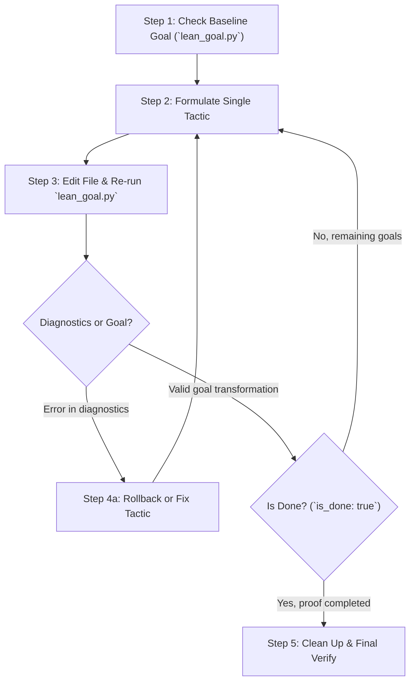

# Lean 4 Interactive Proof

This skill provides an interactive, tactic-by-tactic workflow for formal theorem proving in Lean 4. By querying the Lean 4 Language Server (LSP) in real-time, AI agents can inspect active proof goals (hypotheses and targets), observe goal state transformations, and catch compiler diagnostics immediately after each tactic application.

---

## 1. Core Philosophy: One Step at a Time

Writing formal proofs in Lean 4 differs fundamentally from general software programming:

- **Strict type checking**: Minor discrepancies in types or implicit coercions fail the entire proof.
- **Tactic state feedback**: Every tactic changes the remaining goals. Generating full proofs blindly without observing intermediate states leads to hallucinations and infinite loops.
- **Immediate validation**: Apply exactly one tactic, inspect the resulting goal state and compiler diagnostics, and decide the next step based on the verified state. Never accumulate unverified tactics.

---

## 2. Inspecting Proof Goals (`lean_goal.py`)

The skill bundles `scripts/lean_goal.py`, a standalone, zero-dependency Python script using only the Python standard library to communicate with `lean --server` or `lake serve`.

### CLI Usage

```bash
python3 <skill-path>/scripts/lean_goal.py <lean_file> --line <line_number> [--col <col_number>] [--timeout <seconds>]
```

- `<lean_file>`: Path to the `.lean` source file.
- `--line` (`-l`): **1-indexed** line number (e.g., the line where a tactic was just applied).
- `--col` (`-c`): **1-indexed** column number. Optional; defaults to the end of the line (excluding newline), which is usually the desired position after writing a tactic.
- `--timeout` (`-t`): Elaboration timeout in seconds (default: `8.0`).

### Output Schema (JSON)

````json
{
  "success": true,
  "line": 12,
  "column": 18,
  "rendered": "```lean\nx y : Nat\nh : x = y\n⊢ x + 0 = y\n```",
  "goals": ["x y : Nat\nh : x = y\n⊢ x + 0 = y"],
  "is_done": false,
  "diagnostics": [
    {
      "line": 12,
      "column": 5,
      "severity": "Error",
      "message": "tactic 'rewrite' failed..."
    }
  ],
  "error": null
}
````

- `rendered`: Markdown-formatted string representing the active proof goals, hypotheses, and target.
- `goals`: Array of individual subgoal strings. Empty when all goals are discharged.
- `is_done`: Boolean flag indicating whether all proof goals are completed (`true` when `goals accomplished` or `no goals`).
- `diagnostics`: List of compiler errors, warnings, and informational diagnostics for the file/position.
- `success`: Boolean indicating whether the LSP query completed successfully.

---

## 3. The Interactive Proving Workflow

Always follow this 5-step loop when constructing or repairing a proof:



### Step 1: Query Baseline Goal

Inspect the goal immediately after `:= by` (or at the current point of the incomplete proof):

```bash
python3 scripts/lean_goal.py MathProof.lean --line 10
```

Analyze the returned `rendered` text:

- What are the current hypotheses (above `⊢`)?
- What is the exact target type (after `⊢`)?

### Step 2: Formulate Candidate Tactic

Choose the most direct tactic for the active goal:

- **Definitional equality**: `rfl`
- **Simplification / arithmetic**: `simp`, `ring`, `omega`, `linarith`
- **Hypothesis introduction**: `intro x h`
- **Rewriting / Substitution**: `rw [h]`, `subst h`
- **Splitting cases**: `cases n`, `rcases ...`, `obtain ...`
- **Exact match**: `exact h`

### Step 3: Apply Tactic and Immediately Query

Add the tactic to the file, and run `lean_goal.py` on the modified line.

- Check `diagnostics`: If any `"severity": "Error"` appears, do not proceed to subsequent lines. Fix or replace the failing tactic immediately.
- Check `rendered`: Note how the goal and hypotheses transformed.

### Step 4: Handle Remaining Goals with `done`

When multiple subgoals might be created (e.g., after `induction` or `constructor`):

1. Insert `done` temporarily on the next line.
2. Run `lean_goal.py`.
3. If Lean reports an unsolved goal error on `done`, it prints exactly what subgoals remain.
4. Structure the subgoals using indentation or bullet points (`·`).

### Step 5: Verification & Cleanup

Once `is_done` returns `true` (or `rendered` displays `no goals` / `goals accomplished`):

1. Remove any temporary debugging tactics (e.g., temporary `done`).
2. Run a clean check over the whole proof: verify `diagnostics` has no errors and no `sorry` remaining.
3. Clean up redundancies (e.g., combine multiple consecutive rewrites `rw [h1]; rw [h2]` into `rw [h1, h2]`).

---

## 4. Diagnostics & Error Priority

When `diagnostics` contains messages, prioritize fixing them in this order:

1. **Syntax errors**: Missing brackets, invalid keywords, or indentation mismatches. Higher-level type errors are invalid until syntax is fixed.
2. **Type mismatch**: Argument type does not match parameter type. Explicitly supply type hints or examine implicit coercions.
3. **Tactic failures**: The tactic failed to apply (e.g., `rw` could not find pattern, or `linarith` found no contradiction).
4. **Unsolved goals**: Goal is incomplete. Use `done` or inspect `rendered`.
5. **Linter warnings**: Unused variables, non-terminal `simp`, or naming conventions.

---

## 5. Practical Examples

### Example: Proving Addition Symmetry with Induction

Given target file `AddComm.lean`:

```lean
theorem add_zero_eq (n : Nat) : n + 0 = n := by
  sorry
```

1. Query goal at line 1 (end of line `by`):

   ```bash
   python3 scripts/lean_goal.py AddComm.lean --line 1
   ```

   Output:

   ```lean
   n : Nat
   ⊢ n + 0 = n
   ```

2. Replace `sorry` with `rfl`:

   ```lean
   theorem add_zero_eq (n : Nat) : n + 0 = n := by
     rfl
   ```

3. Query goal at line 2:
   ```bash
   python3 scripts/lean_goal.py AddComm.lean --line 2
   ```
   Output:
   ```json
   {
     "is_done": true,
     "rendered": "no goals",
     "diagnostics": []
   }
   ```
   Proof is verified.

---

## 6. Lake Integration & Environment Handling

- If the Lean file belongs to a Lake package (with `lakefile.lean` or `lakefile.toml`), `lean_goal.py` automatically detects the project root and launches `lake serve`. This ensures all Mathlib modules and dependencies are properly resolved.
- For standalone single files outside any Lake project, `lean_goal.py` automatically falls back to `lean --server`.
- Unicode mathematical characters ($\forall, \exists, \le, \mathbb{N}$) are properly handled via UTF-16 code unit calculation.
