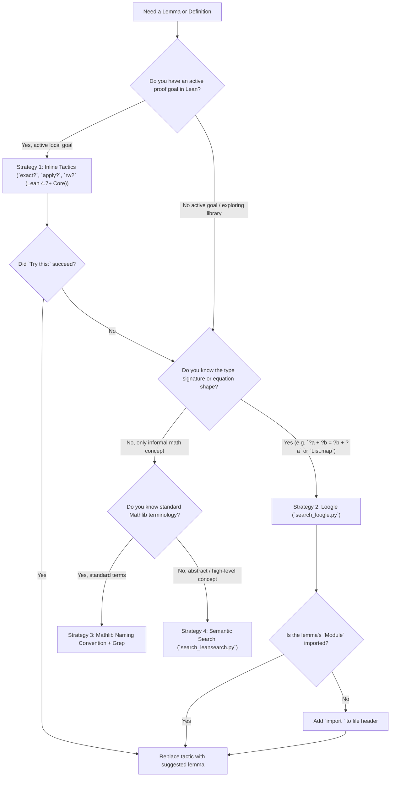

# Lean 4 Mathlib Search

This skill provides a systematic, multi-tiered search methodology for discovering definitions, theorems, and lemmas across Mathlib and the Lean 4 core library.

Mathlib is vast (over 100,000 theorems and definitions). Blind guessing or hallucinating lemma names inevitably fails. Instead, use the structured 4-tiered search pipeline below to locate and verify the exact lemmas required for your proof.

---

## 0. Environment & Version Compatibility

| Component   | Target / Supported          | Verified / Tested Version             | Notes                                                            |
| :---------- | :-------------------------- | :------------------------------------ | :--------------------------------------------------------------- |
| **Lean 4**  | `^4.14.0` (4.14.0+)         | `v4.35.0` (Release, commit `eb6cafb`) | Verified with inline search tactics (`exact?`, `rw?`)            |
| **Mathlib** | Compatible with target Lean | Contemporary with Lean `v4.35.0`      | Indexes modern naming conventions and module layout              |
| **Python**  | `>=3.10`                    | `3.14.x`                              | Required for `scripts/search_loogle.py` & `search_leansearch.py` |

### Version-Specific Search Notes

- **Inline Tactics**: `exact?`, `apply?`, and `rw?` (Lean 4.7+ Core) rely on active goal elaboration in modern Lean 4/Mathlib.
- **External Search APIs**: Loogle and LeanSearch API queries search indexed Mathlib snapshots; ensure lemma names match the target project's Mathlib version.
- **Naming Conventions**: Mathlib camelCase / dot-notation conventions (e.g., `Nat.add_comm`) are stable across 4.x.

---

## 1. Search Strategy Decision Tree

Always consult this decision tree to pick the fastest and most precise tool for your current proof state:



---

## 2. Strategy 1: Inline Tactic Search (`exact?`, `apply?`, `rw?`) (Lean 4.7+ Core)

When working inside a tactic block (`by ...`), Lean 4 provides built-in metaprogramming tactics that search the environment in-memory. This is the **fastest and most deterministic** search method because it operates directly against your exact local proof context (hypotheses and type universe).

| Tactic   | Scope                                                  | Goal Transformation                       | Success Output                 |
| :------- | :----------------------------------------------------- | :---------------------------------------- | :----------------------------- |
| `exact?` | Closes the active goal immediately with a single lemma | Leaves no remaining subgoals              | `Try this: exact <lemma_name>` |
| `apply?` | Matches the conclusion of the goal with a lemma        | Leaves premise conditions as new subgoals | `Try this: apply <lemma_name>` |
| `rw?`    | Searches for equations matching subexpressions         | Rewrites target or specified hypotheses   | `Try this: rw [<lemma_name>]`  |

### Tactic Insertion Workflow

1. **Insert Tactic**: Replace `sorry` or insert the tactic at the active goal line:
   ```lean
   theorem add_comm_example (x y : Nat) : x + y = y + x := by
     exact?
   ```
2. **Collect Compiler Diagnostics**: Run `lake env lean <file>` or use `lean4-interactive-proof` (`lean_goal.py`) to inspect compiler messages.
3. **Extract `Try this:` Suggestion**:
   In older Lean versions, suggestions appear simply as:
   ```text
   Try this: exact Nat.add_comm x y
   ```
   In modern Lean versions (e.g., Lean 4.35+), suggestions may include tactic metadata action tags such as `[apply]`:
   ```text
   Try this: [apply] exact Nat.add_comm x y
   ```
   When automating extraction via script or agent, sanitize the suggestion by stripping the `[tag]` prefix using regex before replacement:
   ```python
   # Robust regex: strips metadata action tags like [apply] using [a-zA-Z]+
   # Prevents accidental removal of actual Lean code brackets (e.g. lists or rw [lemma])
   match = re.search(r"Try this:\s*(?:\[[a-zA-Z]+\]\s*)?([^\n]+)", message)
   clean_replacement = match.group(1).strip() if match else None
   ```
4. **Replace and Validate**: Permanently substitute `exact?` with the sanitized code (`exact Nat.add_comm x y`) and verify diagnostics are clean.
5. **Fallback**: If `exact?` fails (goal cannot be closed in one step), fall back to `apply?` or `rw?`.

### Limitations & Performance Considerations

While inline tactics are powerful and direct, keep these two critical constraints in mind:

1. **Strictly Limited to Imported Modules**:
   - `exact?`, `apply?`, and `rw?` only index declarations that are **already imported** in the current file.
   - If Mathlib contains the exact lemma you need, but its module is not yet imported, inline tactics will fail with `no applicable declaration found`.
   - **Rule**: If an inline tactic fails on a standard mathematical fact, **do not assume Mathlib lacks the lemma**. Switch immediately to **Strategy 2 (Loogle)** to search the entire global Mathlib index.

2. **Computational Overhead & Heartbeat Exhaustion**:
   - Searching via `rw?` or `apply?` in files with broad imports (e.g. `import Mathlib`) initiates higher-order unification against tens of thousands of candidate lemmas.
   - This can cause language server freezes, long compilation hangs, or `(deterministic) timeout at ... maximum heartbeat count exceeded` errors.
   - **Remedy**:
     - Maintain granular imports (e.g. `import Mathlib.Data.Nat.Basic`) rather than monolithic ones.
     - Never leave unresolved `exact?`, `apply?`, or `rw?` calls in a saved file; if they do not produce a suggestion within a few seconds, delete them and query `search_loogle.py` via CLI.

---

## 3. Strategy 2: Type Signature Search via Loogle (`search_loogle.py`)

When inline tactics fail or when searching outside an active proof file, use **Loogle**. Loogle evaluates structural type patterns and nonlinear metavariables against Mathlib's entire index.

The skill bundles `scripts/search_loogle.py`, a standalone Python script supporting both the public Loogle REST API and local `loogle` CLI.

### CLI Usage

```bash
python3 <skill-path>/scripts/search_loogle.py "<query>" [-n <limit>] [--json] [--local] [--prefer-local] [--lake-dir <dir>]
```

- `<query>`: The search query string. Enclose in quotes.
- `-n`, `--limit`: Maximum number of results to display (default: `10`, `0` for all).
- `--json`: Output full structured JSON containing declaration names, modules, and signatures.
- `--local`: Run search locally via `lake exe loogle` or `loogle` CLI. Automatically detects Lake projects in current/parent workspace directories, or uses `--lake-dir` / `LOOGLE_PROJECT_DIR`.
- `--prefer-local`: Use local `loogle` if available, falling back to the REST API.
- `--lake-dir`: Path to a Lake project directory containing `loogle` (optional; auto-detected if omitted).
- `--timeout`: Timeout in seconds (default: `25.0`).

### Local Loogle Prerequisites & Setup

When running Loogle locally via `--local` or `--prefer-local`, note the following environment requirements and build behaviors:

1. **Root Package Dependency Declaration**:
   - `lake exe loogle` requires `loogle` to be registered as an executable target in your **root project's Lake configuration**.
   - **Crucial**: Even if `.lake/packages/loogle` exists on disk (e.g., from transitive dependencies or previous clones), Lake will fail with `error: ... unknown executable loogle` unless explicitly declared in your root project configuration:
     - In `lakefile.toml`:
       ```toml
       [[require]]
       name = "loogle"
       git = "https://github.com/leanprover-community/loogle.git"
       ```
     - In `lakefile.lean`:
       ```lean
       require loogle from git "https://github.com/leanprover-community/loogle.git"
       ```

2. **Pre-building Executable & Timeout Considerations**:
   - On the first invocation, `lake exe loogle` initiates compilation of the `loogle` executable and its Lean dependencies. This compilation frequently takes 60–120+ seconds, exceeding the default CLI timeout (`25.0` seconds) and causing an abort.
   - **Recommended Workflow**: Pre-build the executable explicitly before running search queries:
     ```bash
     lake update loogle
     lake build loogle
     ```
   - **On-the-fly Build Timeout**: If invoking `search_loogle.py --local` without a prior build, supply a higher `--timeout` on the first invocation:
     ```bash
     python3 <skill-path>/scripts/search_loogle.py "<query>" --local --timeout 180
     ```
   - Once compiled, subsequent local queries execute within sub-second to a few seconds.

### Loogle Query Syntax Guide

Loogle provides expressive query patterns:

| Pattern Type           | Syntax         | Example                            | Purpose / Meaning                                     |
| :--------------------- | :------------- | :--------------------------------- | :---------------------------------------------------- |
| **Anonymous Wildcard** | `_` or `?_`    | `_ * (_ ^ _)`                      | Any expression or type                                |
| **Nonlinear Wildcard** | `?a`, `?b`     | `Real.sqrt ?a * Real.sqrt ?a`      | Same variable must match identically on both sides    |
| **Constant Inclusion** | Identifier     | `Real.sin` or `List.map`           | Statement must reference this constant                |
| **Name Substring**     | `"string"`     | `"differ"`                         | Declaration identifier contains the substring         |
| **Conclusion Filter**  | `\|- ...`      | `\|- tsum _ = _ * tsum _`          | Target conclusion (right of `→` and `∀`) matches      |
| **Prop vs Type**       | `⊢ (_ : Prop)` | `⊢ (_ : Prop)`                     | Filter only for theorems/proofs (exclude definitions) |
| **Compound Query**     | `,` (comma)    | `"differ", Real.sin, ⊢ (_ : Prop)` | Logical **AND** of all specified criteria             |

### Practical Examples

```bash
# 1. Non-linear pattern: product of square roots of the same number
python3 scripts/search_loogle.py "Real.sqrt ?a * Real.sqrt ?a"

# 2. Function composition with Measurable
python3 scripts/search_loogle.py "Measurable ?f -> Measurable ?g -> Measurable (?g ∘ ?f)"

# 3. Filtering by constant and name substring
python3 scripts/search_loogle.py '"differ", Real.sin' -n 5

# 4. JSON output for automated agent parsing
python3 scripts/search_loogle.py "List ?a -> (?a -> ?b) -> List ?b" --json
```

### Module Resolution & Import Workflow

A very common pitfall when using Loogle is the **`unknown identifier` compiler error**. Loogle searches across the **entire Mathlib index**, but declarations will NOT be available in your Lean file unless their enclosing module is imported.

Whenever you find a candidate lemma via Loogle, execute this 3-step workflow before referencing it in your code:

1. **Locate the `Module` attribute in the search result**:
   - In text mode output:
     ```text
     1. Real.sin
        Type   : (x : ℝ) : ℝ
        Module : Mathlib.Analysis.Complex.Trigonometric
     ```
   - In `--json` output:
     ```json
     {
       "name": "Real.sin",
       "type": "(x : ℝ) : ℝ",
       "module": "Mathlib.Analysis.Complex.Trigonometric"
     }
     ```
2. **Add the import to your Lean file header**:
   Insert the required module path at the top of your Lean file:

   ```lean
   import Mathlib.Analysis.Complex.Trigonometric
   ```

   > **Note on Granular Imports**: Prefer importing the specific module (e.g. `import Mathlib.Analysis.Complex.Trigonometric`) rather than the monolithic `import Mathlib`. Granular imports drastically reduce compile times and memory consumption during build and language server elaboration.

3. **Verify declaration resolution**:
   Confirm the lemma is accessible in your environment (e.g. via `#check Real.sin` or checking diagnostics with `lean_goal.py`) before attempting to close proof goals with it.

---

## 4. Strategy 3: Mathlib Naming Conventions

Mathlib follows strict, predictable naming conventions. If you know the types and operations involved, you can often deduce the exact lemma name deterministically.

### Core Structure: `Type.operation_property` or `concept_subconcept`

- **Namespace**: Governed by the primary type (e.g., `Nat`, `Real`, `List`, `Continuous`).
- **Operation**: The head symbol or operation (`add`, `mul`, `sub`, `neg`, `map`, `comp`).
- **Property**: The mathematical property or relation (`comm`, `assoc`, `zero`, `one`, `mono`, `le`, `lt`, `eq`).

### Standard Suffix Vocabulary

| Suffix             | Meaning                                                     | Example                           |
| :----------------- | :---------------------------------------------------------- | :-------------------------------- |
| `_comm`            | Commutativity ($a \star b = b \star a$)                     | `Nat.add_comm`, `mul_comm`        |
| `_assoc`           | Associativity ($(a \star b) \star c = a \star (b \star c)$) | `add_assoc`, `mul_assoc`          |
| `_left` / `_right` | Left/right side orientation                                 | `mul_one`, `one_mul`, `div_self`  |
| `_zero` / `_one`   | Neutral element interaction                                 | `add_zero`, `zero_add`, `mul_one` |
| `_self`            | Operation applied to identical arguments ($a \star a$)      | `mul_self_sqrt`, `sub_self`       |
| `_mono`            | Monotonicity                                                | `List.map_mono`, `add_le_add`     |
| `_of_...`          | Implication / constructor from a premise                    | `le_of_lt`, `eq_of_sub_eq_zero`   |
| `_iff`             | If and only if ($\iff$) equivalence                         | `mul_eq_zero_iff`, `subset_def`   |

### Verification via Fast Grep / `lean_goal.py`

Once a candidate name is deduced:

1. Search within Mathlib imports:
   ```bash
   rg "theorem add_comm" .lake/packages/mathlib/Mathlib/
   ```
2. Verify immediately with `lean4-interactive-proof`:
   ```lean
   #check Nat.add_comm
   ```

---

## 5. Strategy 4: Semantic & Natural Language Search (`search_leansearch.py`)

When you do not know the exact Lean type signature or Mathlib naming pattern, but know high-level mathematical terminology in informal English (e.g., "Banach-Steinhaus theorem", "Heine-Borel compactness", "order of element divides group order", "intermediate value theorem"), use **LeanSearch**.

The skill bundles `scripts/search_leansearch.py`, allowing autonomous coding agents and terminal users to query the LeanSearch REST API (`https://leansearch.net/search`) directly without opening a web browser.

### CLI Usage

```bash
python3 <skill-path>/scripts/search_leansearch.py "<query>" [-n <limit>] [--json] [-t <timeout>]
```

- `<query>`: Natural language mathematical concept or theorem name in English.
- `-n`, `--limit`: Maximum number of results to display (default: `10`, `0` for all).
- `--json`: Output full structured JSON containing declaration names, modules, signatures, kinds, and informal descriptions.
- `-t`, `--timeout`: Query timeout in seconds (default: `15.0`).

### Practical Examples

```bash
# 1. Query famous named theorem by mathematical concept
python3 scripts/search_leansearch.py "Banach-Steinhaus theorem" -n 3

# 2. Query informal property in group theory
python3 scripts/search_leansearch.py "the order of a group element divides the order of the group" -n 2

# 3. Retrieve JSON for programmatic parsing
python3 scripts/search_leansearch.py "Heine-Borel theorem" -n 1 --json
```

### Sample Output

```text
LeanSearch Results [LEANSEARCH] for: "Banach-Steinhaus theorem"
Matched 2 declaration(s):
======================================================================
1. banach_steinhaus (theorem) [Distance: 0.2447]
   Module  : Mathlib.Analysis.Normed.Operator.BanachSteinhaus  (use `import Mathlib.Analysis.Normed.Operator.BanachSteinhaus`)
   Type    : ∀ {E : Type u_1} {F : Type u_2} {𝕜 : Type u_3} {𝕜₂ : Type u_4} ...
   Concept : Banach-Steinhaus Theorem (Uniform Boundedness Principle)
   Summary : Let E and F be normed spaces over nontrivially normed fields...
----------------------------------------------------------------------
```

### Headless Agent Exploration Workflow

1. **Query Concept**: Run `search_leansearch.py "<concept>"` to discover candidate declarations and their enclosing Mathlib module.
2. **Add Module Import**: Extract the `Module` field and insert `import <Module>` at the top of your Lean file.
3. **Pinpoint & Verify**: Use `search_loogle.py` or inline `exact?` / `#check` to confirm the lemma resolves cleanly in your proof context.

---

## 6. Best Practices & Anti-Patterns

### Anti-Patterns to Avoid

- **Assuming inline tactic failure means Mathlib lacks the lemma**: `exact?` and `rw?` only inspect transitively imported modules in the current file. If an inline search fails on a reasonable mathematical step, do not assume the theorem does not exist in Mathlib; transition to Loogle (`search_loogle.py`) to search the global library.
- **Leaving expensive inline search tactics active under broad imports**: Inserting `rw?` or `apply?` into a file that imports monolithic modules (such as `import Mathlib`) triggers unbounded unification across tens of thousands of declarations, causing severe language server lag or heartbeat exhaustion errors.
- **Forgetting to import the lemma's module**: Loogle searches the entire Mathlib corpus across all unimported modules. Finding a lemma like `Real.sin` or `Real.sqrt_le_sqrt` does NOT mean it is currently in scope. Always extract the `Module` attribute from the result and add `import <Module>` to your file header before using it.
- **Never guess lemma names without checking**: Hallucinating identifiers (e.g., `Mathlib.Theorem.pythagorean`) causes `unknown identifier` compilation errors.
- **Do not overload Loogle queries**: Writing overly complex signatures with 10 type variables causes Loogle timeouts. Start with key constants or subexpressions (e.g., `_ * (_ ^ _)`), then refine.
- **Avoid plain text searches in Loogle**: Querying `"Measure.map"` as a type signature yields 0 hits because Loogle searches structural types. For constant presence, omit quotes (`Measure.map`); for name substring, use quotes (`"map"`).
- **Relying on `--local` Loogle without root requirement or pre-building**: Running `search_loogle.py --local` in a project where `.lake/packages/loogle` exists but `loogle` is not declared as a direct dependency in `lakefile.toml` / `lakefile.lean` will fail with `unknown executable loogle`. Furthermore, invoking local Loogle for the first time without pre-building (`lake build loogle`) can trigger a long build exceeding the default 25-second timeout. Always declare `loogle` in the root lakefile and pre-build it.

### Verification Checklist

- [ ] Identified active goal with `lean_goal.py`?
- [ ] Attempted inline `exact?` / `apply?` / `rw?` first on active goals?
- [ ] If inline tactics failed or timed out, transitioned to Loogle search (`search_loogle.py`)?
- [ ] If using `--local` Loogle, confirmed `loogle` is declared in root `lakefile.toml`/`lakefile.lean` and pre-built (`lake build loogle`)?
- [ ] Checked search result `Module` and added `import <Module>` to the Lean file header?
- [ ] Verified that the identifier resolves cleanly (`#check <lemma_name>`)?
- [ ] Checked for clean compilation without `sorry` or warnings?
