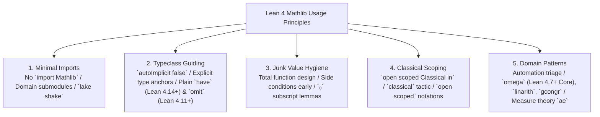
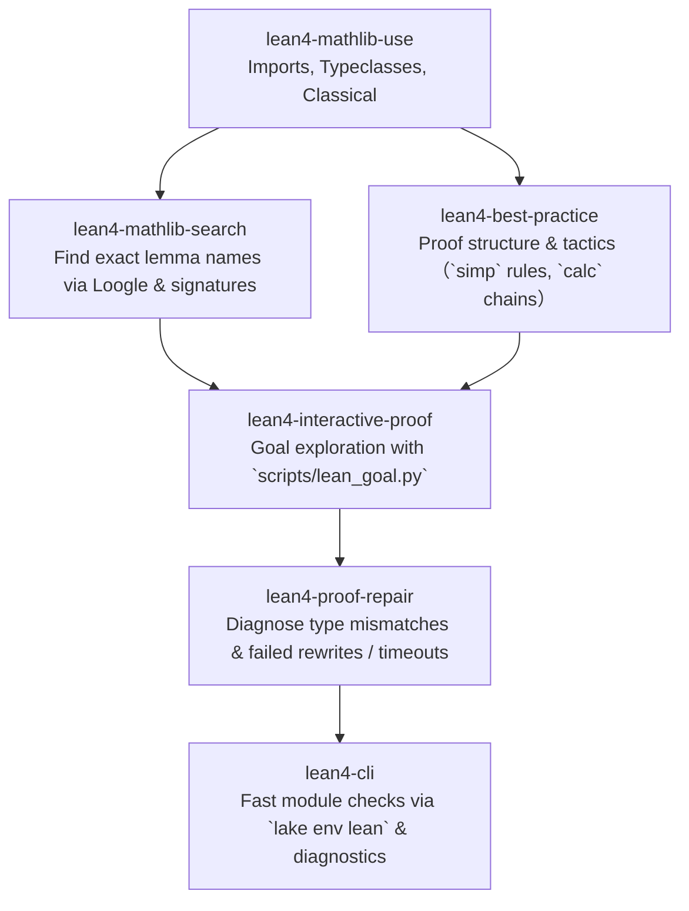

# Lean 4 Mathlib Usage Guide

This skill provides an authoritative guide for AI agents and human practitioners on navigating and leveraging the Mathlib mathematical library efficiently, cleanly, and without compilation bottlenecks.

---

## 0. Environment & Version Compatibility

| Component   | Target / Supported  | Verified / Tested Version             | Notes                                                     |
| :---------- | :------------------ | :------------------------------------ | :-------------------------------------------------------- |
| **Lean 4**  | `^4.14.0` (4.14.0+) | `v4.35.0` (Release, commit `eb6cafb`) | Verified against modern Mathlib module structures         |
| **Mathlib** | `v4.14.0`+          | Contemporary with Lean `v4.35.0`      | Uses scoped classical opening and granular module imports |

### Version-Specific Conventions

- **Modular Imports**: Avoid monolithic `import Mathlib`. In contemporary Mathlib, import only domain submodules (e.g., `Mathlib.Data.Nat.Basic`) and prune via `lake exe shake`.
- **Classical Scoping**: Use `open scoped Classical in` instead of global `open Classical` to satisfy Mathlib linters.
- **Instance Management**: Use plain anonymous `have` (Lean 4.14+) rather than `haveI` (deprecated since Lean 4.14), and `omit [...] in` (Lean 4.11+) to control instance scope.

---

## 1. The Five Pillars of Mathlib Usage

Adhering to these five foundational practices ensures maintainable, performant, and linter-compliant formalizations across Mathlib:

1. **Minimal & Targeted Imports**: Never rely on monolithic `import Mathlib`. Select domain-specific modules (`.Defs`, `.Basic`) to minimize elaboration footprint and cache invalidation. Prune redundant imports using `lake shake`.
2. **Typeclass & Instance Control**: Guard against invisible dependency explosions, ambiguous synthesis paths, and instance pollution. Disable `autoImplicit`, pin numeric literals with explicit type annotations (e.g., `(0 : ℝ)`), register local instances using standard `have : C := ⟨pf⟩` (Lean 4.14+) (avoiding legacy `haveI` (deprecated since Lean 4.14)), pin ambient instances when defining sub-structures, and exclude unwanted section variables with `omit [...] in` (Lean 4.11+).
3. **Total Function & Junk Value Discipline**: Recognize that Mathlib assigns default values (junk values) to classically undefined expressions (e.g., $x / 0 = 0$, non-differentiable derivatives = $0$). Formulate side conditions (`y ≠ 0`, `DifferentiableAt`, `Summable`) before attempting rewrites or cancellations (`mul_div_cancel₀`).
4. **Scoped Classical Logic & Notations**: Respect the `openClassical` style linter. Confine classical logic to individual theorems (`open scoped Classical in`) or tactic blocks (`classical`). Use `open scoped` for notations (`BigOperators`, `Pointwise`) to avoid namespace pollution.
5. **Domain-Specific Patterns & Triage**: Select targeted decision procedures before manual rewrites (`omega` (Lean 4.7+ Core) for $\mathbb{N}/\mathbb{Z}$, `linarith` for $\mathbb{R}/\mathbb{Q}$, `gcongr` for relational congruence, `positivity` for nonnegativity). Apply verified domain conventions (e.g., `Integrable.of_bound` with `ae_of_all`, `filter_upwards` for almost everywhere hypotheses, `measurability` and `fun_prop` for function properties).

---

## 2. Fast Mathlib Authoring Checklist

Before running verification or committing code that uses Mathlib, check against this list:

### Stage A: Module Imports & Toolchain

- [ ] **No Monolithic Imports**: Is the file free of `import Mathlib`? Are imports restricted to minimal submodules (e.g., `Mathlib.Basic.Real.Basic`, `Mathlib.Tactic.Linarith`)?
- [ ] **Binary Cache Synchronized**: Has `lake exe cache get` been executed to avoid rebuilding dependencies from source?
- [ ] **Pruned Dependencies**: Has `lake shake` (or `lake shake --fix`) been run to eliminate unused transitive modules? _(Note: `lake shake` requires standard module identifier paths and fails on paths with hyphens or non-modules; see [minimal_imports_and_shake.md](references/minimal_imports_and_shake.md))_

### Stage B: Elaboration & Typeclass Settings

- [ ] **`autoImplicit` Disabled**: Is `set_option autoImplicit false` active to prevent accidental free variables?
- [ ] **Anchored Types**: Are numeric constants and expressions with coercions explicitly type-annotated (e.g., `(0 : ℝ)`, `(n : ℝ)`)?
- [ ] **Modern Instance Injection**: If typeclass resolution fails, is standard `have : C := pf` (Lean 4.14+) used (avoiding deprecated `haveI` (deprecated since Lean 4.14) which triggers linter warnings)?
- [ ] **Instance Pollution Guarded**: When working with sub-structures (e.g. `MeasurableSpace`, `MetricSpace`, `Preorder`), is the ambient instance pinned (`[m0 : ...]`) and ambient facts passed via `@`? Are unneeded ambient section variables excluded with `omit [...] in` (Lean 4.11+)?

### Stage C: Hypotheses & Domain Validity

- [ ] **Non-Zero Conditions**: When performing division or inverses in fields, is the non-zero hypothesis (`h : y ≠ 0`) established and the `₀`-subscript lemma used (`mul_inv_cancel₀`)?
- [ ] **Calculus / Analysis Prerequisites**: When differentiating or summing series, are domain proofs (`DifferentiableAt`, `Summable`, `ContinuousAt`) proven before applying algebraic formulas?

### Stage D: Classical Scoping & Notation

- [ ] **Linter-Compliant Classical Logic**: Is classical logic scoped via `open scoped Classical in` (for declarations) or `classical` (in tactics), avoiding global `open Classical`?
- [ ] **Noncomputable Section**: If constructing noncomputable mathematical data with `Classical.choice`, is the section marked `noncomputable section`?
- [ ] **Scoped Notations**: Are notations activated via `open scoped BigOperators Pointwise` rather than global `open` statements?

### Stage E: Domain Patterns & Automation Triage

- [ ] **Right Tactic Selected**: Is `omega` (Lean 4.7+ Core) used for $\mathbb{N}/\mathbb{Z}$, `linarith` for $\mathbb{R}/\mathbb{Q}$, `ring` for polynomials, `positivity` for $>0/\ge 0$, and `gcongr` for sum/integral inequalities?
- [ ] **Measure Theory Conventions**: Is integrability proven via bounded+measurable (`Integrable.of_bound`), `ae` properties combined via `filter_upwards`, and measurability discharged via `measurability` / `fun_prop`?

---

## 3. Progressive Reference Guides

For comprehensive technical explanations, domain-by-domain modules, and code patterns, consult the detailed references:

| Topic                               | Key Techniques & Best Practices                                                                                                                          | Reference Guide                                                                         |
| :---------------------------------- | :------------------------------------------------------------------------------------------------------------------------------------------------------- | :-------------------------------------------------------------------------------------- |
| **Minimal Imports & Shake**         | Eliminating `import Mathlib`, domain submodule catalog, `lake exe cache get`, running `lake shake --fix`                                                 | [minimal_imports_and_shake.md](references/minimal_imports_and_shake.md)                 |
| **Typeclasses & Structures**        | Multiple inheritance, invisible dependencies, `autoImplicit false`, plain `have` (Lean 4.14+), avoiding instance pollution, `omit [...] in` (Lean 4.11+) | [typeclasses_and_structures.md](references/typeclasses_and_structures.md)               |
| **Junk Values & Partial Functions** | Total functions in type theory, junk values table ($x/0$, `deriv`, `tsum`, `sSup`), subscript-`₀` convention, domain preconditions                       | [junk_values_and_partial_functions.md](references/junk_values_and_partial_functions.md) |
| **Classical Logic & Scoping**       | `openClassical` style linter, single-declaration scoping, `classical` tactic, `noncomputable section`, `open scoped` notations                           | [classical_logic_and_scoping.md](references/classical_logic_and_scoping.md)             |
| **Domain-Specific Patterns**        | Analysis, measure theory (`Integrable.of_bound`, `ae_of_all`), geometry betweenness (`Sbtw`), algebra automation (`gcongr`, `ring`)                      | [domain_specific_patterns.md](references/domain_specific_patterns.md)                   |

---

## 4. Synergy with Lean 4 Skills Ecosystem

`lean4-mathlib-use` coordinates with the full suite of specialized Lean 4 skills:

- **Before Searching**: Configure minimal imports with `skills/lean4-mathlib-use` so search tools like `skills/lean4-mathlib-search` operate on focused namespaces.
- **During Proving**: Use `skills/lean4-interactive-proof` to test local state transitions and verify side conditions for partial functions.
- **Applying Best Practices**: Structure proofs according to `skills/lean4-best-practice` (`calc` mode, `have` decomposition) while adhering to `lean4-mathlib-use` import and scoping rules.
- **Handling Errors**: If typeclass synthesis or rewrites fail, diagnose and fix them using `skills/lean4-proof-repair`.
- **Validation**: Run fast checks and full builds using `skills/lean4-cli`.
