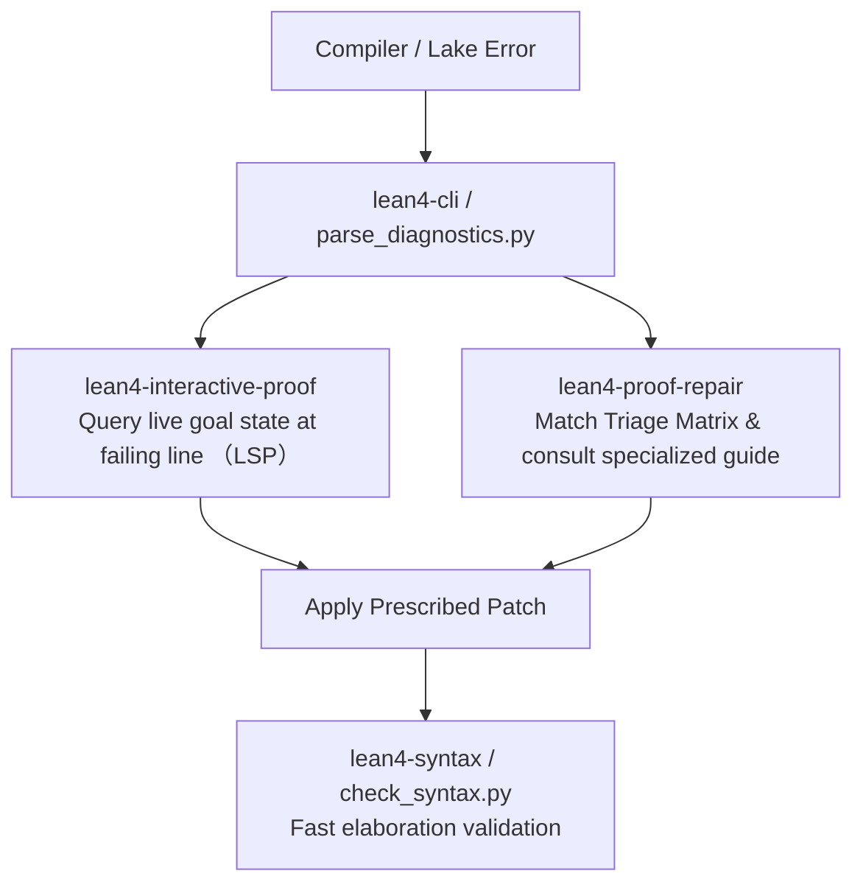

# Lean 4 Proof Repair Guide

This skill provides a systematic protocol and catalog of prescriptions for diagnosing and fixing Lean 4 compiler, elaborator, and tactic errors.

When formalizing mathematical proofs, compiler failures are inevitable. Rather than randomly guessing tactics, follow the **Triage Matrix** and **Repair Protocol** below to pinpoint root causes and apply principled fixes.

---

## 0. Environment & Version Compatibility

| Component   | Target / Supported          | Verified / Tested Version             | Notes                                                |
| :---------- | :-------------------------- | :------------------------------------ | :--------------------------------------------------- |
| **Lean 4**  | `^4.14.0` (4.14.0+)         | `v4.35.0` (Release, commit `eb6cafb`) | Verified across diagnostic & repair benchmarks       |
| **Mathlib** | Compatible with target Lean | Contemporary with Lean `v4.35.0`      | Uses modern tactic suite (`omega`, `grind`, `aesop`) |

### Version-Specific Diagnostics & Caveats

- **Arithmetic Decisions**: `omega` is the primary decision procedure for `ℕ`/`ℤ` linear integer arithmetic in Lean 4 (superseding `linarith` for discrete variables).
- **Automation Tactics**: Experimental tactics like `grind` depend on newer Lean 4 releases; verify availability if targeting older toolchains.
- **Instance Synthesis**: On Lean 4.14+, synthesized instances use automatic anonymous caching; avoid legacy `haveI` unless targeting legacy codebases.

---

## 1. Quick Triage Matrix

Find your error message below to identify the root cause and immediate remedy:

| Error Signature                         | Core Mechanism                                               | Immediate Remedy                                                                  | Reference Guide                                                           |
| :-------------------------------------- | :----------------------------------------------------------- | :-------------------------------------------------------------------------------- | :------------------------------------------------------------------------ |
| `type mismatch`                         | Incompatible types or missing coercions                      | Add coercion `↑x`, type hint `(x : T)`, or unfold via `change`/`dsimp`            | [type_mismatch.md](references/type_mismatch.md)                           |
| `synthesized: m, inferred: inst✝`       | Instance pollution (local binding shadows ambient instance)  | Pin ambient instance `[m0 : ...]`, pass ambient facts via `@`, or `omit [...]`    | [instance_synthesis.md](references/instance_synthesis.md)                 |
| `motive is not type correct`            | Dependent type blocked in `rw`                               | Use `subst`, `revert ...; rw; intro`, or switch to `simp_rw` / `congr!`           | [dependent_rewriting.md](references/dependent_rewriting.md)               |
| `failed to synthesize instance`         | Missing typeclass in context or classical reasoning required | Add `[Class α]` to binders, `open scoped Classical`, or anonymous `have : C`      | [instance_synthesis.md](references/instance_synthesis.md)                 |
| `maximum number of heartbeats (200000)` | Non-terminating `simp` loop or unbounded search              | Replace open `simp` with `simp only`, scope `linarith only [...]`, or sublemmas   | [timeout_and_heartbeats.md](references/timeout_and_heartbeats.md)         |
| `tactic 'linarith' failed`              | Non-linear terms or discrete `ℕ`/`ℤ` variables               | Use `omega` for `ℕ`/`ℤ`; use `nlinarith` or `positivity` for non-linear `ℝ`       | [tactic_failures.md](references/tactic_failures.md)                       |
| `tactic 'omega' failed`                 | Real numbers or non-linear products                          | Use `linarith` for `ℝ`/`ℚ`; decompose non-linear terms                            | [tactic_failures.md](references/tactic_failures.md)                       |
| `tactic 'ring' failed`                  | Inequality goal or unexpanded hypothesis                     | Use `linarith`/`gcongr` for inequalities; `rw [h]` before `ring`                  | [tactic_failures.md](references/tactic_failures.md)                       |
| `tactic 'grind' failed`                 | Search space explosion or dominant single-domain problem     | Use `grind (splits := 0)`, query `grind?`, or switch to `omega`/`linarith`/`ring` | [tactic_failures.md](references/tactic_failures.md)                       |
| `tactic 'exact' failed`                 | Incomplete arguments or small mismatch                       | Change `exact` to `refine ?_` to expose missing subgoals                          | [tactic_failures.md](references/tactic_failures.md)                       |
| `unsolved goals`                        | Missing case handling or stray goals                         | Insert `done` to expose remaining goals; isolate branches with `·`                | [unsolved_goals.md](references/unsolved_goals.md)                         |
| `unknown identifier`                    | Unqualified name or missing Mathlib import                   | Add namespace prefix (e.g. `Nat.add_comm`) or `import Mathlib`                    | [unknown_identifier.md](references/unknown_identifier.md)                 |
| **Persistent failure (3+ attempts)**    | Underlying claim is mathematically false or lacks premise    | Probe boundary values ($0, 1, \emptyset$); test negation `¬ Target`               | [falsification_and_disproof.md](references/falsification_and_disproof.md) |

---

## 2. Standard Proof Repair Protocol

When a Lean file or code block fails verification, execute these four stages:

### Stage 1: Localize with Precision

1. **Parse Diagnostics**:
   Extract structured error diagnostics (file, line, column, severity, message).
   _Tip_: Use `skills/lean4-cli/scripts/parse_diagnostics.py` to convert compiler output into JSON.
2. **Inspect the Tactic State**:
   Inspect the exact hypotheses and goal target at the failing line.
   _Tip_: Use `skills/lean4-interactive-proof/scripts/lean_goal.py` to query the live LSP tactic state without full rebuilds.

### Stage 2: Classify the Failure

Determine which category the error belongs to:

- **Type/Elaboration error**: Occurs before tactics execute (syntax, unknown identifier, type mismatch, instance synthesis).
- **Tactic progress error**: The tactic cannot advance the goal (motive failure, decision procedure failure, timeout).
- **Tactic termination error**: Tactics ran out of steps or left hanging goals (`unsolved goals`, unsolved metavariables).
- **Semantic / Falsity suspicion**: Tactics repeatedly fail with no progress; proposition may be false or missing hypotheses (switch to counterexample search).

### Stage 3: Consult Detailed Reference

Load only the specialized guide matching the diagnosed error category:

- For coercions, `Prop` vs `Bool`, and DefEq gaps: see [type_mismatch.md](references/type_mismatch.md).
- For `rw` failing with dependent types: see [dependent_rewriting.md](references/dependent_rewriting.md).
- For missing `Decidable`, `Fintype`, or algebraic instances: see [instance_synthesis.md](references/instance_synthesis.md).
- For `simp` loops and 200,000 heartbeats limits: see [timeout_and_heartbeats.md](references/timeout_and_heartbeats.md).
- For `omega`, `linarith`, `ring`, `grind`, `aesop`, `gcongr` failures: see [tactic_failures.md](references/tactic_failures.md).
- For unclosed goals and branching errors: see [unsolved_goals.md](references/unsolved_goals.md).
- For naming and import lookup: see [unknown_identifier.md](references/unknown_identifier.md).
- For persistent failures and counterexample refutation: see [falsification_and_disproof.md](references/falsification_and_disproof.md).

### Stage 4: Apply & Verify the Patch

1. Apply the minimal edit (e.g. changing `exact` to `refine`, switching `rw` to `simp_rw`, adding `open scoped Classical`).
2. Run fast file-level verification:
   ```bash
   lake env lean path/to/File.lean
   ```
   Or use `skills/lean4-syntax/scripts/check_syntax.py` on the edited snippet.
3. Confirm that no downstream proofs were broken.

---

## 3. Synergy with the Lean 4 Skills Ecosystem

`lean4-proof-repair` works directly alongside adjacent skills:



---

## 4. Key Rules of Thumb for Robust Proofs

1. **Never leave open `simp` in the middle of a proof**:
   Non-terminal `simp` makes proofs fragile across Mathlib updates. Use `simp only [...]` or `dsimp only [...]`.
2. **Strictly isolate every branching goal with focus dots (`·`)**:
   Do not allow multiple goals to be processed sequentially without `·`. It hides bugs and misplaces error markers.
3. **Use `omega` for integers/naturals, `linarith` for rationals/reals**:
   Mixing up their domains is the #1 cause of arithmetic decision tactic failures.
4. **Prefer `refine` over `exact` when debugging**:
   `refine` creates helpful subgoals for any missing conditions, whereas `exact` immediately throws a fatal type mismatch.
5. **Epistemological Strictness in Refutation (Append-Only Rule)**:
   When disproving a target, report `REFUTED` strictly after Lean certifies the negation under standard axioms. Treat informal witnesses as `WITNESS_UNCERTIFIED`. Never overwrite the original theorem declaration—always append the certified counterexample theorem alongside it.
