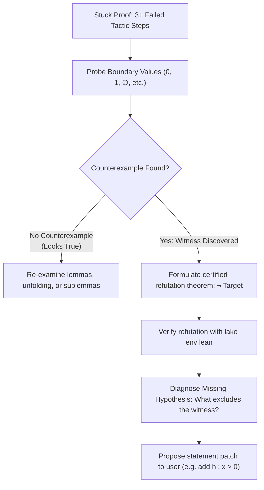
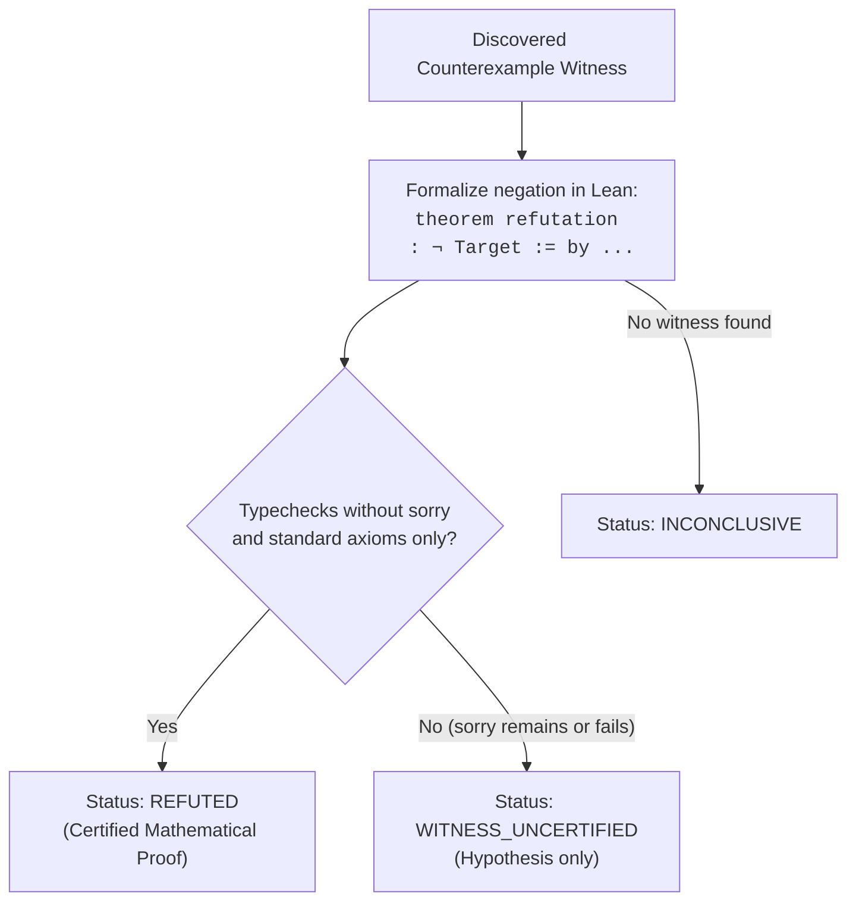

# Falsification and Counterexample Search Guide

When a formal mathematical proof repeatedly fails despite diverse tactic attempts, the underlying statement is often **mathematically false** or **missing necessary hypotheses**.

This guide provides a systematic, computational protocol for refuting unprovable claims, discovering counterexamples, and repairing defective statements without wasting tokens on impossible proofs.

---

## 1. Why Falsify Before Looping?

AI agents risk entering infinite search loops when attempting to prove false or under-constrained propositions:

- A goal like `n ≤ n * n` holds for all $n \in \mathbb{N}$, but `n < n * n` fails for $n = 0, 1$.
- A theorem assuming `[Group G]` asserting $x * y = y * x$ fails unless $G$ is abelian (`[CommGroup G]`).
- A lemma asserting $a / b * b = a$ fails if $b = 0$.

**The Rule of Three**: If three consecutive proof attempts (e.g. `simp`, `omega` (Lean 4.7+ Core)/`linarith`, and library search) fail to make progress, **pause proving and test for counterexamples**.

---

## 2. Refutation Recipes by Target Shape

To refute a goal in Lean 4, construct a formal proof of its negation (`¬ Target`). A claim is rigorously **refuted** once Lean compiles the negation without `sorry`.

### Shape 1: Universal Quantifiers (`∀ x : α, P x`)

- **Goal to Refute**: `∀ x : α, P x`
- **Refutation Strategy**: Find a specific witness $w : \alpha$ such that $\neg P(w)$.
- **Lean 4 Pattern**:
  ```lean
  -- Refutation via explicit counterexample witness:
  theorem counterexample_exists : ∃ x : ℕ, ¬ (x < x * x) := by
    use 0
    decide
  ```
- **Disproving the Universal Claim**:
  ```lean
  theorem false_claim_refuted : ¬ (∀ x : ℕ, x < x * x) := by
    intro h
    have h0 := h 0
    revert h0
    decide
  ```

---

### Shape 2: Conditional Statements (`∀ x, P x → Q x`)

- **Goal to Refute**: `∀ x, P x → Q x`
- **Refutation Strategy**: Find a witness $w$ satisfying premise $P(w)$ but violating conclusion $Q(w)$ (i.e. $P(w) \land \neg Q(w)$).
- **Lean 4 Pattern**:
  ```lean
  -- Claim: Every continuous function on ℝ is differentiable
  -- Counterexample: Absolute value function f(x) = |x| at x = 0
  theorem diff_claim_refuted : ¬ (∀ (f : ℝ → ℝ), Continuous f → Differentiable ℝ f) := by
    intro h
    have h_abs_cont : Continuous (fun x : ℝ => |x|) := continuous_abs
    have h_abs_diff := h (fun x => |x|) h_abs_cont
    -- Deduce contradiction at x = 0...
  ```

---

### Shape 3: Concrete Equalities or Inequalities

- **Goal to Refute**: $a = b$ or $a \le b$ for concrete numerical or algebraic expressions.
- **Refutation Strategy**: Directly evaluate the negation using computational decision tactics.
- **Lean 4 Pattern**:

  ```lean
  -- Equalities refuted by norm_num or decide:
  example : ¬ (2 + 2 = 5) := by norm_num
  example : 2 + 2 ≠ 5     := by decide

  -- Inequalities refuted by omega (Lean 4.7+ Core) or norm_num:
  example : ¬ (10 ≤ 3)    := by omega
  ```

---

### Shape 4: Finite Domain Claims

- **Goal to Refute**: Claims over `Fin n`, `Bool`, or small enumerated types.
- **Refutation Strategy**: Exhaust the search space using `decide` or `fin_cases`.
- **Lean 4 Pattern**:
  ```lean
  -- Exhaust finite cases automatically:
  example : ¬ (∀ (b : Bool), b && true = false) := by
    decide
  ```

---

## 3. Heuristic Boundary-Value Probing

When testing whether an open conjecture has a counterexample, probe these canonical boundary values first:

| Domain                    | Canonical Boundary Candidates                                                              |
| :------------------------ | :----------------------------------------------------------------------------------------- | --- | ---------------------- |
| **Natural Numbers (`ℕ`)** | `0`, `1`, `2`, powers of 2                                                                 |
| **Integers (`ℤ`)**        | `0`, `1`, `-1`, `-2`, large negative numbers                                               |
| **Reals (`ℝ`) / Floats**  | `0`, `1`, `-1`, $1/2$, non-differentiable $                                                | x   | $, boundary infinities |
| **Sets (`Set α`)**        | `∅` (empty set), `Set.univ` (universe), singletons `{x}`                                   |
| **Lists / Collections**   | `[]` (empty list), `[x]` (single element), duplicate elements `[x, x]`                     |
| **Algebraic Structures**  | Trivial group $\{1\}$, cyclic group $\mathbb{Z}_2$, non-commutative group $S_3$ or $GL(n)$ |
| **Topological Spaces**    | Discrete topology, indiscrete/trivial topology, Sierpiński space                           |

---

## 4. Triage & Repair Workflow

When a counterexample is discovered:



### Reporting Template to User

When an impossible proof or missing assumption is diagnosed, report with clarity:

````text
The current lemma statement appears unprovable because a counterexample exists:

- Failing Target: `∀ (n : ℕ), n < n * n`
- Counterexample Witness: `n = 0` (or `n = 1`)
- Certified Check: `0 < 0 * 0` reduces to `0 < 0`, which is false (`by decide`).

Recommended Statement Fix:
Add hypothesis `(h : 2 ≤ n)` or `(h : 1 < n)` to the theorem signature:
```lean
theorem corrected_theorem (n : ℕ) (hn : 2 ≤ n) : n < n * n
```
````

---

## 5. Epistemological Strictness: The Certification Ladder

In mathematical theorem proving, an informal counterexample or an intuition that a statement is false is merely a **hypothesis** until certified by the Lean 4 type checker. Agents must classify the refutation status according to three strict tiers:



| Certification Status      | Definition & Invariants                                                                                                                                                                                                                | Required Agent Action                                                                    |
| :------------------------ | :------------------------------------------------------------------------------------------------------------------------------------------------------------------------------------------------------------------------------------- | :--------------------------------------------------------------------------------------- |
| **`REFUTED`**             | Lean 4 has typechecked a proof of `¬ Target` (or `∃ w, ¬ P w`) under `lake lean <file>` (Lean 4.8+) or `lake env lean <file>` without `sorry` and depending strictly on standard axioms (`propext`, `Classical.choice`, `Quot.sound`). | Report the claim as certified false. Provide the certified refutation lemma to the user. |
| **`WITNESS_UNCERTIFIED`** | A candidate counterexample witness $w$ was identified (e.g. via boundary probing or Python), but the formal refutation proof is incomplete or contains `sorry`.                                                                        | Present as an unverified hypothesis. Do NOT claim the theorem has been refuted.          |
| **`INCONCLUSIVE`**        | Neither proof nor refutation could be synthesized within search limits.                                                                                                                                                                | Report obstacles encountered; request user guidance on missing mathematical lemmas.      |

---

## 6. The Append-Only Refutation Rule

When refuting a target declaration in a shared codebase, agents must strictly follow the **Append-Only Rule**:

1. **Never Erase or Overwrite the Target**: Do NOT delete the original declaration or overwrite its header. The original target represents the user's formalization task.
2. **Append the Refutation Declaration**: Place the certified counterexample theorem immediately following the original target, appended with a clear suffix (e.g. `_counterexample` or `_refuted`):

   ```lean
   -- Keep original target declaration intact:
   theorem my_target (n : ℕ) : n < n * n := by
     sorry

   -- Append certified refutation alongside it:
   theorem my_target_counterexample : ∃ n : ℕ, ¬ (n < n * n) := by
     use 0
     decide
   ```

3. **Escalate to User**: Present the two declarations and the diagnosed hypothesis fix, waiting for explicit user approval before adjusting the original statement.
